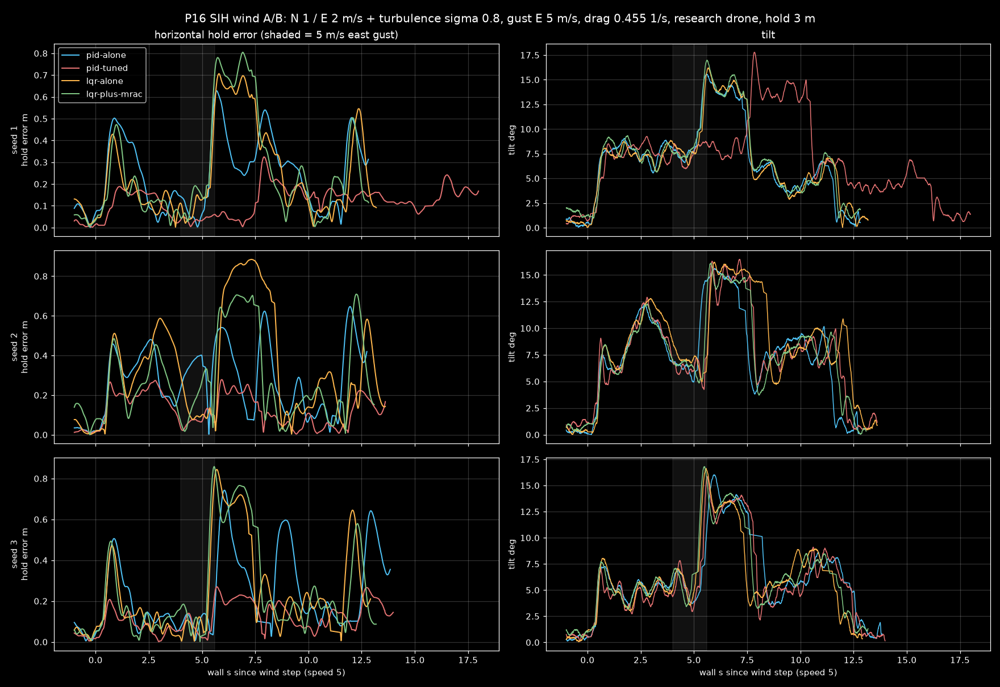

# PROGRESS — done-checks for OPEN-ITEMS

An item counts as done only when its check is pasted here. Labels: [S] = simulated, [D] = documented, [A] = assumed.

## P3 — mrac_layers module builds and routes (2026-11-03)
- [S] `~/PX4-mrac` (copy of v1.17.0) builds with `mrac_layers` (rate/att/pos) via `px4-mrac/rebuild.sh`, EXIT=0.
- [S] Mode 2 (route only) gives u_ad = 0 and theta = 0 on all three layers (arms run below).

## P4 — rate layer: hover + fig8 pass, adapts under disturbance, on/off A/B — DONE
Run: `arms.py 8 ~/PX4-mrac 5 mrac-off mrac-dist-route mrac-dist-adapt ...`, SIH, x500, 5 seeds per arm.
Output: `~/.cache/px4-arms/20261103T154656`, 35/35 PASS.

| metric (mean [min..max], n=5) | off | route (MRAC off, disturbance on) | adapt (MRAC on, disturbance on) |
|---|---|---|---|
| dist_rate_rms (rad/s) | – | 0.171 [0.167..0.173] | 0.107 [0.105..0.108] |
| dist_roll_peak_deg | – | 7.86 [7.37..8.97] | 4.44 [3.73..5.10] |
| dist_peak_rp (rad/s) | – | 0.853 [0.749..0.925] | 0.582 [0.428..0.645] |
| rms_track_err_m (fig8) | 3.00 | 2.98 | 2.94 |
| max_tilt_deg | 35.2 | 34.5 | 35.4 |
| theta_end / uad_max | – | 0 / 0 | 0.079 / 0.085 |

[S] The rate layer cuts the disturbance rate error by 38 % and the roll peak by 43 %. It does not hurt fig8 tracking.

## P5 — att/pos layers
- [S] Same arms run: the pos layer adapts (dist_z_peak 0.289 → 0.221 m, theta 0.22) but sits at the UMAX 0.15 clamp. The att layer barely adapts (theta 0.012, roll peak 8.05 vs 8.01°) at MRL_A_GAM 1. A gain sweep is pending.
- [S] Gain sweep, 5 seeds per arm (`~/.cache/px4-arms/20261103T162537`, 15/15 PASS): att u_ad grows with gain, but the roll peak under the rate-torque disturbance does not move.

  | metric (mean [min..max]) | route | GAM 5 | GAM 10 |
  |---|---|---|---|
  | att_uad_max | 0 | 0.134 [0.132..0.138] | 0.201 [0.194..0.212] |
  | dist_roll_peak_deg | 7.67 [6.20..8.43] | 7.90 [6.06..8.89] | 7.31 [6.83..7.77] |
  | dist_rate_rms | 0.167 | 0.166 | 0.168 |

  Reading: the disturbance (`MRL_DIST_R`) is a torque at the rate loop, and the inner rate loop already absorbs most of it, so an attitude-level layer has little left to fix. The att arm needs an attitude-level mismatch (CG offset / thrust imbalance) as its test case.
- [S] Pos UMAX 0.25 / LIM 0.5 (`~/.cache/px4-arms/20261103T161428`): 3/5 pass; max_hold_err 0.83..1.57 m vs route 0.42..0.70 m. The larger authority hurts hover hold, so keep UMAX 0.15.
- [S] Att layer with a degraded inner loop (MC_ROLLRATE_K/PITCHRATE_K 0.5, SIH_T_TAU 0.08, MRL_A_GAM 5, fig8 size 8 period 10 ×3), 5 seeds per arm, `~/.cache/px4-arms/20261103T163757`, 15/15 PASS. `att_track_rms_deg` = RMS of roll/pitch error vs vehicle_attitude_setpoint over the airborne flight.

  | metric (mean [min..max]) | healthy route | slow route | slow adapt |
  |---|---|---|---|
  | att_track_rms_deg | 2.89 [2.77..2.95] | 4.98 [4.92..5.09] | 4.51 [4.39..4.58] |
  | rms_track_err_m | 2.99 | 3.65 [3.63..3.68] | 3.48 [3.43..3.53] |
  | att_uad_max | 0 | 0 | 0.167 [0.158..0.192] |

  Reading: with a weak inner loop the att layer cuts attitude tracking error by 9 % and fig8 position error by 5 %, ranges do not overlap. It recovers about a fifth of the gap to the healthy loop.
- [S] **Per-loop ladder** on the slow-inner-loop case (MC_ROLL/PITCHRATE_K 0.5, SIH_T_TAU 0.08, A_GAM 5; DIST_R 0.08 + DIST_T 0.08 step, then fig8 8 m / 10 s ×2). 5 seeds per arm, `~/.cache/px4-arms/20261103T164855`, **20/20 PASS**.

  | metric (mean [min..max]) | all off | rate | rate+att | rate+att+pos |
  |---|---|---|---|---|
  | dist_roll_peak_deg | 17.98 [15.2..19.5] | 6.26 [5.14..6.99] | 5.70 [4.73..6.32] | 5.99 [4.53..8.11] |
  | dist_rate_rms (rad/s) | 0.343 | 0.144 | 0.140 | 0.143 |
  | att_track_rms_deg | 4.25 [4.12..4.37] | 3.99 [3.87..4.07] | 3.68 [3.65..3.71] | 3.86 [3.66..4.32] |
  | dist_z_peak_m | 0.235 | 0.375 [0.12..0.84] | 0.306 | 0.213 [0.13..0.32] |
  | rms_track_err_m (fig8) | 3.67 | 3.65 | 3.47 | 3.41 [3.35..3.46] |
  | max_hold_err_m | 0.84 | 0.69 | 0.64 | 0.68 |
  | rate_rms_rp | 0.148 | 0.118 | 0.117 | 0.165 [0.119..0.260] |
  | uad_max rate / att / pos | – | 0.114 / – / – | 0.115 / 0.159 / – | 0.261 / 0.355 / 0.150 (clamp) |

  Reading: each layer added on top helps its own loop. Rate cuts the roll peak 65 %. Att cuts attitude error a further 8 %. Pos cuts the z peak and fig8 error. With all three on, two seeds show layer interaction: rate rms up to 0.26, att theta up to 1.1, att u_ad reaching its 0.5 limit, and pos sitting at its UMAX clamp. Stacked layers need a time-scale separation rule: each outer reference model slower than the inner one. That is the thesis's multi-time-scale claim, and it is now testable.
- **P5 DONE** (ladder with ≥5 seeds per arm, pasted above). Follow-up for P10/P11: sweep the outer reference-model tau (MRL_A_TAU, MRL_P_TAU) to remove the all-on interaction.
- Tooling lesson: float PX4 params in scenario JSON must be written as floats (5.0). An int makes `get_param_int` fail with WRONG_TYPE and the arm never flies.

## P8 — research-drone model from real data (M0 + M1 done; M2 log validation open)
- M0 [D]/[A]: `research/research_drone_params.yaml`, every value with range, label and source. Mass 0.9885 kg [A] (firmware MASS_KG, never weighed), inertia xx/yy/zz 0.01389/0.01539/0.01133, kF 6.80e-6 N/(rad/s)^2 (Σω² over 6 flights, drift-investigation report), ω_max 969 rad/s, kM 0.109 (7× x500, flagged), motor tau 0.0505 s, 15 ms delay (not modelled in gz).
- M0 [S]: `vehicles/research_drone/gen_model.py` builds model.sdf from the x500 base (0.1 m rotor offsets, scaled meshes, 4 MulticopterMotorModel); `gz sdf -k` → Valid. Airframe `4051_gz_research_drone` (CA rotors ±0.1, KM ±0.109, EC 150..969, MPC_THR_HOVER 0.55).
- M1 [S]: `scenario.py 1 scenarios/rd-gz-hover.json` (gz, speed 1, 3 m, 30 s hold) → PASS. Max drift 0.083 m (limit 0.3), max tilt 0.58°, landed. `~/.cache/px4-runs/rd-m1-20261103T163722`. Height error 0.28 m during hold: to check against MPC_THR_HOVER in M2.
- Tooling fix: scenario.py now stops when the sim launcher exits (the first M1 try used instance 9, px4ctl allows 0..8, and waited 600 s on a dead launcher).
- M2 hover check [S] (rd-m1 ULog, 23.7 s hold window): motor cmd 0.472 (per motor 0.468..0.476), actuator_outputs / esc_status 534..539 rad/s. Real drone [D]: hover throttle 0.545 [0.48..0.55], 5700 rpm = 597 rad/s [518..674]. **Mismatch**: the sim hovers 11 % slower in rotor speed and below the real throttle range. The SDF is correct (4 plugins, motorConstant 6.8e-6, total mass 1.053 kg), yet gz holds 10.33 N at 536 rad/s, an effective constant of 8.99e-6, 1.32× the set value. The cause is not found (candidates: the gz_bridge EC_MIN/MAX map, or a MulticopterMotorModel scaling term). Next: read gz-sim MulticopterMotorModel thrust code; then either calibrate motorConstant to 5.15e-6 (hover 597 rad/s) or fix the root cause.
- **M2 hover root cause [S] (2026-11-03 23:55).** A JointStatePublisher was added to the model to read the gz rotor joints in hover (`rd-gz-hover`). With kM 0.109, rotor_0/1 (ccw) ran at 620–640 rad/s and rotor_2/3 (cw) at 410–433, while PX4 commanded 539/539/532/532. The rotors did not follow the command, and the thrust did not balance. With kM 0.016 (x500 value) and everything else unchanged, all four joints run at 615 rad/s, esc 614.8 ×4, motors 0.567. That equals √(m g / 4 Kt) = 616 for 1.053 kg, and the real hover is 597 [518..674] rad/s at cmd 0.545. **Fix:** K_M 0.016 [A] in `gen_model.py` and CA_ROTORx_KM ±0.016 in `4051_gz_research_drone`. The 0.109 twin fit is dropped as non-physical for gz. The real yaw coefficient still needs a yaw-step fit (M2 open below).
- **M2 rate-loop delay [S] vs [D] (2026-11-04 01:40).** Method: a 12-tone multisine torque dither (0.5–20 Hz, MRL_ID_AMP 0.06, roll then pitch, 30 s each) in a gz hover (`scenarios/rd-gz-id.json`). The FRF is the instrumental-variable estimate S_dy/S_du, and the fit `k e^{-sT}/(s(τs+1))` uses the **same** `ground_station/autotune/frf.fit_plant` as the real drone's fit (`agent/plant_fit.py`). That makes this the frequency-domain method of Tischler-style rotorcraft ID, run apples to apples.

  | gz added delay | roll τ / T | pitch τ / T | rel. residual |
  |---|---|---|---|
  | 0 ms (stock) | 0.045 s / 10.2 ms | 0.046 s / 10.1 ms | 0.10 |
  | 12 ms | 0.048 / 21.4 | 0.049 / 21.1 | 0.10 |
  | **3 ms** | 0.049 / **13.3** | 0.050 / **12.7** | 0.09 |
  | real [D] | angle-roll fit 0.042 / 14.1 | rate-pitch fit 0.068 / 12.85 (rel. res. 0.49) | — |

  The added delay shows up 1:1 (12 ms → +11 ms), so the method is sound. **Decision:** +3 ms puts the sim delay inside the real 12.85–14.1 ms. Sim τ 0.045–0.050 lies inside the two real fits (0.042–0.068), so the motor time constant stays at 0.0505 s; nothing was tuned to match. gz MulticopterMotorModel has no transport delay and PX4 has no sim-delay parameter, hence a small custom patch (`px4-mrac/patch_gz_delay.py`, a ring buffer in the gz-bridge ESC output). It is driven by the PX4 param `SIM_GZ_ACT_DLY` (ms), so every ULog records it. Airframe 4051 sets the default to 3. Check after rebuild (no env var, airframe default, `rd-gz-id-20261103T232719`): the ULog shows SIM_GZ_ACT_DLY 3, and the fit gives roll 0.049 s / 13.2 ms, pitch 0.050 s / 12.8 ms, rel. residual 0.09 → **M2 delay DONE**.
- M2 gyro noise, OPEN: the SDF sets gz IMU stddev 0.022 rad/s. Measured at sim hover: sensor_combined diff estimate 0.0105 rad/s, vehicle_angular_velocity high-pass 0.012 rad/s. The real value in `plant.py` is 12 dps at 1 kHz, mostly motor vibration, from a different estimator. These cannot be compared yet. Next: the same estimator (filtered rate std at hover) on a real hover log and on the sim.
- M2 open: attitude step response vs real `lab_d_sysid_angle` (2026-10-28) flight.

## P9 — LQR / ADRC / MPC xy baselines in PX4 (first pass)
- [S] Plant fit (`px4-mrac/xyc_design.py` on mrac-off-1 ULog): a = k·lag(u) − D·v. u = tilt-implied acceleration from vehicle_attitude_setpoint (125 Hz; lpos setpoint is logged at only 9.6 Hz and aliases). Matched 3 Hz filtfilt; output-error grid. Result: al 0.3679 (tau 0.02 s, grid floor, so the lag is absorbed into the delay), dc gain 0.927, drag D 0.886 1/s, delay 9 steps = 180 ms, residual 0.155 m/s² (0.81 without the drag term). LQR K = [2.78 1.90 0.081 0.68], closed-loop |eig| max 0.993.
- [S] Module: `mrac_layers/XyCtrl.{hpp,cpp}` (XYC_MODE 0 PID / 1 LQR / 2 ADRC / 3 MPC FISTA) publishes trajectory_setpoint_xyc (acceleration-only xy). mc_pos_control follows it when XYC_MODE ≥ 1 (`patch_pos_xyc.py`). Build PASS.
- [S] `arms.py 8 ~/PX4-mrac 5 xyc-{pid,lqr,adrc,mpc}` (SIH, hold 8 s + fig8 8 m / 12 s ×2), `~/.cache/px4-arms/20261103T171139`, **20/20 PASS**.

  | metric (mean [min..max]) | PID (stock) | LQR | ADRC | MPC |
  |---|---|---|---|---|
  | rms_track_err_m (fig8) | 3.01 [2.98..3.06] | 3.50 [3.39..3.59] | 3.67 [3.55..3.78] | 3.65 [3.42..3.81] |
  | max_hold_err_m | 0.69 [0.29..1.07] | 0.68 [0.38..1.15] | 1.11 [1.07..1.15] | 0.74 [0.48..0.87] |
  | att_track_rms_deg | 2.99 | 3.10 | 3.84 | 3.17 |
  | rate_rms_rp | 0.086 | 0.090 | 0.114 | 0.091 |
  | max_tilt_deg | 36.0 | 22.38 | 23.16 | 22.39 |

  Reading: all three fly stably. Their max tilt pins at 22.4° = atan(XYC_AMAX 4.0 / g), so they are acceleration-saturated on the fig8, while stock PID uses up to 36°. The tracking gap is therefore not yet a fair controller comparison. Next: XYC_AMAX 7.0 (35°) rerun, then a hold-only step test without saturation.
- [S] Rerun with XYC_AMAX 7.0 (cap 35.5°, same as PID's 36° use), `~/.cache/px4-arms/20261103T172349`, **15/15 PASS**:

  | metric (mean [min..max]) | PID (above) | LQR a7 | ADRC a7 | MPC a7 |
  |---|---|---|---|---|
  | rms_track_err_m (fig8) | 3.01 | **2.52** [2.48..2.57] | 2.96 [2.93..3.01] | **2.52** [2.45..2.56] |
  | max_hold_err_m | 0.69 | 0.67 [0.44..1.02] | 1.03 [0.95..1.09] | 0.61 [0.53..0.69] |
  | att_track_rms_deg | 2.99 | 3.00 | 4.49 | 3.03 |
  | rate_rms_rp | 0.086 | 0.082 | 0.107 | 0.080 |
  | max_tilt_deg | 36.0 | 35.1 | 35.4 | 35.2 |

  Reading: at equal tilt authority, LQR and MPC track the fig8 16 % better than stock PID, with the same or lower rate activity. ADRC matches PID on tracking but holds worse (1.03 m) and is busier (rate_rms +24 %). Its ESO bandwidth (4·XYC_WC = 6 rad/s) is a tuning lever, not tuned here. LQR and MPC agree to 0.01 m: the constraints are inactive at AMAX 7, so MPC reduces to LQR, as expected.
- **P9 DONE** (baselines built, fitted, flown 5 seeds each, fair comparison pasted). Follow-ups: ADRC XYC_WC sweep (P12 cloud sweep candidate).

## P6 — sim deck with gates catches a known oscillating case — DONE
- Gates (`agent/gates.py`): osc_amp_rad_s = peak of the Hann-averaged spectrum of roll/pitch rate error in [1.5 Hz, Nyquist·0.9] over the longest airborne stretch; sat_pct; max_tilt_deg; landed.
- [S] Calibration: osc_amp over all 45 healthy arm flights (hover + disturbance + fig8) = 0.030..0.040 rad/s. Gate set to 0.06 (1.5× healthy max).
- [S] Known-bad case `scenarios/decks/osc-rollrate-p.json`: SIH_T_TAU 0.2 (motor lag; the 0.05 default never rings), rate P 1.0, D 0.01 → osc 0.103 rad/s at 4 Hz.
- [S] `deck.py 8 scenarios/decks/rate-osc.json --src ~/PX4-mrac` → 01-mrac-off pass (0.034 @ 3 Hz), 02-osc-rollrate-p fails at osc_amp_rad_s. 2/2 matched, `~/.cache/px4-decks/rate-osc-20261103T161134`.
- Lesson: SIH with near-zero actuator lag hides gain-induced oscillation (P ×8 stayed stable). Decks that hunt oscillation must set a realistic SIH_T_TAU.

## P7 — black reports + Rerun .rrd + ONE dark index (in progress)
- [S] report.py: plotly_dark + `#000` page and plot backgrounds, checked by screenshot on mrac-dist-adapt-1.
- [S] `agent/rrd.py RUN_DIR...` → flight.rrd (7.4 MB for an 80 s run): static preset path (orange) + flown path (blue), moving drone pose, pos/att/rates/motors/MRAC plots, event text log on one sim-time axis.
- [S] `agent/index.py` → ONE dark page `~/.cache/px4-index.html` over every campaign in ~/.cache/px4-* (27 campaigns, newest first, collapsible). Per run: PASS/FAIL, key metrics, links to report/rrd. Decks show the gate verdict (`osc_amp_rad_s (expect osc_amp_rad_s)`). Checked by screenshot via `python3 -m http.server 8792` in ~/.cache. **P7 DONE.**

## P10 — rate+att MRAC on every xy baseline under a roll-torque disturbance — DONE (2026-11-03)
SIH, speed 5, 5 runs per arm, same scenario per arm (takeoff, hold, MRL_DIST_R step, fig8, land); arm = baseline
xy controller (XYC_MODE) x adaptive layers off / rate+att on (MRL_EN_RATE=1, MRL_EN_ATT=1). Mean [min..max]. [S]
Sources: lqr-off from ~/.cache/p10arms.log (batch 1, 5 runs); lqr-ra/adrc ~/.cache/px4-arms/20261103T223344;
mpc ~/.cache/px4-arms/20261103T224438.

| arm | pass | dist roll peak deg | dist rate rms rad/s | att track rms deg | fig8 rms m | hold max m | dist z peak m |
|---|---|---|---|---|---|---|---|
| lqr off | 5/5 | 16.5 [15.7..17.4] | 0.336 | 4.51 | 3.19 | 0.70 | 0.27 |
| lqr +MRAC | 5/5 | 5.19 [4.76..6.21] | 0.138 | 3.92 | 3.05 | 0.70 | 0.19 |
| adrc off | 4/5 | 19.9 [16.9..22.0] | 0.363 | 6.08 | 3.75 | 1.47 | 0.30 |
| adrc +MRAC | 5/5 | 5.54 [4.04..7.13] | 0.152 | 5.38 | 3.65 | 1.45 | 0.18 |
| mpc off | 5/5 | 17.0 [16.8..17.2] | 0.340 | 4.54 | 3.20 | 0.88 | 0.22 |
| mpc +MRAC | 5/5 | 4.71 [4.18..5.60] | 0.133 | 3.93 | 3.08 | 0.79 | 0.21 |

Check: the adaptive layers cut the disturbance roll peak 3.0-3.6x and the rate error 2.4x on all three baselines,
with no run failing (ADRC off had 1/5 fail). Ranges do not overlap for roll peak or rate rms. Same direction as the
PID ladder (17.98 -> 5.70 deg). uad_max 0.11-0.20, att_uad_max 0.16-0.27 (below MRL limits). Controller-agnostic
claim holds in SIH for the inner loops. Fig8 rms is dominated by the xy baseline (ADRC worst), not the layers.
Note: px4ctl accepts instances 0..8 only; instance 9 "hung" because the sim never started (arms.py now refuses it).

## P12 — cloud sweeps on GitHub Actions (pipeline done; sweeps next)
- Public repo https://github.com/YoussefChouj/px4-mrac-sim (sim tooling only, BSD-3). Workflow `arms.yml`: plan → build (PX4 v1.17.0 + px4-mrac patches, SIH-only `bin`+`etc` tarball, cached by patch hash) → fly (matrix, one scenario×run per runner, fail-fast off) → collect (Markdown table + `all.json`).
- Smoke run 1 (41657285352) failed at build: `apply.sh` needs `xyc_gains.h`, which was not in the repo. Fixed by committing the generated header (aadddfc), with the ULog paths stripped.
- **Smoke run 2 (41658077476) [S]: success.** Build 6 min (cold cache), each fly job 1 min, collect OK. `all.json`: mrac-off rate_rms_rp 0.084, hold max 1.28 m; mrac-dist-adapt dist_roll_peak 3.76°, dist_rate_rms 0.104, uad_max 0.087, hold max 0.62 m. Both pass. One run per arm, so this checks the pipeline, not the statistics. For comparison, the local P10 +MRAC arms (5 runs each, all three xy controllers) gave 4.04–7.13°.
- Next: dispatch sweeps with `runs` 10 (outer tau, ADRC XYC_WC, P11 campaign).

## P11-prep — outer reference-model tau sweep (cloud, 2026-11-04)
- **Setup.** GH Actions run 41666014724: 53 jobs, all success. Base: `ladder-all.json` (SIH, all 3 layers, degraded plant MC_*RATE_K 0.5 + SIH_T_TAU 0.08, DIST_R/T 0.08, hold + 2 fig8 laps). Arms: MRL_A_TAU {0.15, 0.30, 0.60} × MRL_P_TAU {0.5, 1.0, 2.0}, plus ladder-off; 5 runs each. Rate tau fixed at 0.06.
- **Prediction (written before the results).** Larger outer tau means less layer interaction, but slower outer rejection.
- **Medians [S]** (half-range in brackets):

| arm | fig8 rms m | dist roll peak ° | rate rms | rate u_ad max | runs with u_ad at the clamp | tilt max ° |
|---|---|---|---|---|---|---|
| ladder-off | 3.71 | 19.99 | 0.151 | – | – | 42.1 |
| a0.15 p0.5 (default) | 3.48 | 6.50 | 0.155 | 0.300 | 4/5 | 42.5 |
| a0.15 p1.0 | 3.44 | 5.70 | 0.120 (0.24) | 0.123 | 2/5 | 42.6 |
| a0.15 p2.0 | 3.41 | 5.61 | 0.119 (0.14) | 0.294 | 3/5 (≥0.29) | 42.2 |
| a0.30 p0.5 / p1.0 / p2.0 | 3.78 / 3.73 / 3.71 | 6.40 / 5.80 / 5.78 | 0.169 / 0.123 / 0.120 | 0.300 | – | ~40.6 |
| a0.60 p0.5 / p1.0 / p2.0 | 4.36 / 4.27 / 4.27 | 6.15 / 5.85 / 5.59 | 0.155 / 0.119 / 0.130 | 0.26–0.30 | – | ~36.1 |

- **Reading.**
  - Every adaptive arm cuts the disturbance roll peak about 3× (20° to 5.6–6.5°).
  - A slower attitude tau costs fig8 tracking: 0.30 matches off and 0.60 is +15%. The lower tilt there is sluggishness, not better control.
  - A slower position tau (0.5 to 1.0) lowers the rate rms (0.155 to 0.120) and the disturbance peak (6.5° to 5.7°) without hurting tracking. Going to 2.0 adds nothing.
- **Decision: keep MRL_A_TAU 0.15 and set MRL_P_TAU 1.0.** That is 2.5× rate→att and 6.7× att→pos. The literature's 3–5× per loop is roughly met; a slower attitude loop measurably hurts tracking.
- **Finding (separate problem): rate-layer parameter drift is bimodal.** In every arm, some runs end with the rate θ at about 0.9–1.1 and u_ad pinned at UMAX 0.3. The rest end at θ 0.1–0.3 and u_ad around 0.11.
  - The worst run (a0.15 p1.0 #4) has rate rms 0.60 and att rms 7.7°, which is a burst.
  - Outer tau changes how often the drift happens, not whether it happens. So the cause is in the rate law itself (σ 0.05, γ 2, the clamp acting as saturation), not in loop separation.
  - Next item (P11 blocker): find what drives θ (its time history in a drifting ULog). Then pick a standard robust-MRAC fix (dead-zone, e-mod, or a projection bound tied to the u_ad limit, as in Ioannou & Sun ch. 8) by physical cause, not to make the number pass.

## P11-prep — root cause of the θ drift, and the fix (local SIH, tau-a015-p100 ×3, 2026-11-04)
- **Cause (from the ULog θ history, `drift_digest.py`).** The rate θ wound up at 60–61 s, while the vehicle was still airborne during the fast final descent, with a motor at 0.00. The land detector reported ground_contact at 63.8 s and maybe_landed at 64.8 s. So the adaptive law kept integrating error the mixer could not act on: actuator saturation, not loop separation.
- **Attempt 1, rejected: gate on maybe_landed** (the same gate as mc_rate_control's integrator; kept because it is harmless). Arms run 20261103T235442: θ_end 0.27–0.67 and u_ad max 0.19–0.30. Not fixed.
- **Fix: saturation-aware adaptation, reusing PX4's own rule.** MracLayers subscribes to `control_allocator_status`. Per axis it sets sat_pos/sat_neg from `unallocated_torque` exactly as `MulticopterRateControl::setSaturationStatus` does. `MracAxis::step` drops the gradient term when it would push u further into a saturated direction, or past its own UMAX clamp. Leakage still runs.

| run (local, 3×) | θ_end rate | u_ad max rate | rate rms | fig8 track [m] | pos u_ad max | pass |
|---|---|---|---|---|---|---|
| maybe_landed only (…235442) | 0.27–0.67 | 0.19–0.30 | 0.148 | 3.49 | 0.150 | 3/3 |
| + saturation-aware (…000057) | 0.096 [0.090..0.106] | 0.116 [0.109..0.126] | 0.132 | 3.37 | 0.150 | 3/3 |
| + pos gate on ground_contact (…001204) | 0.098 [0.093..0.103] | 0.106 [0.101..0.110] | 0.129 | 3.35 | 0.150 | 3/3 |

- **The position layer gate now copies mc_pos_control.** It freezes on ground_contact (PX4 resets its velocity integrator on `flying_but_ground_contact`). Touchdown windup is smaller (e at touchdown went from −0.4/−0.5 to −0.19) but not gone.
- **Open finding: the position layer bias duplicates PX4's vz integrator.** θ[1] builds to about −0.15 during the takeoff climb (mean e +0.11–0.14) and stays there through the fig8. u_ad then sits at the 0.15 clamp 9–16% of the flight. PX4's velocity integrator and hover-thrust estimate already hold that constant, so the sum is fixed and the split between the two drifts, with only σ pulling it back.
  - Candidate standard fixes, to decide by cause: use the baseline closed loop as the reference model (Lavretsky & Wise, adaptive augmentation), or drop the bias regressor on a layer whose baseline has integral action.
  - Not fixed yet. The P11 thrust-disturbance arm needs it, because a layer pinned at its clamp has no authority left.
- MRL_P_TAU default set to 1.0 (the decision above).

## P11-prep — position layer drops the bias regressor (MRL_P_BIAS, local SIH, ×3 per arm, 2026-11-04)

Why: the pos layer's bias θ[1] (≈ −0.15) duplicated PX4's vz integrator and hover-thrust estimator, which already
integrate the constant thrust error. Two integrators on one constant form a null direction that only σ splits, so u_ad
sat at its 0.15 clamp mid-flight. Adaptive augmentation of a baseline with integral action drops that bias term so the
adaptive loop does not fight the nominal integrator (arXiv 1604.01882; Lavretsky & Wise style augmentation).
Change: `MracAxis::bias`; new param MRL_P_BIAS (default 0 = off), read by MracPosLayer. Rate/att layers keep the bias.

One build, arms differ only in MRL_P_BIAS. Run `~/.cache/px4-arms/20261104T002650`, all 12 flights PASS.

| Metric (mean [min..max]) | fig8 bias off | fig8 bias on | thrust step bias off | thrust step bias on |
|---|---|---|---|---|
| pos u_ad at clamp, whole flight | 0.000–0.077 | 0.069–0.121 | 0.050–0.059 | 0.000–0.114 |
| where the clamp hits | touchdown only (60–67 s) | mid-flight (19–68 s) | touchdown only (42–46 s) | mid-flight (18–27 s) in 1/3 |
| dist_z_peak_m (thrust −0.08 step) | – | – | 0.220 [0.179..0.295] | 0.289 [0.113..0.415] |
| rms_track_err_m | 3.507 [3.489..3.532] | 3.345 [3.272..3.407] | – | – |
| rate_rms_rp | 0.134 | 0.128 | 0.091 | 0.083 |

Reading:
- With the bias off, the in-flight clamp is gone. In fig8 run 1 the largest in-flight |u_ad| is 0.088 (t 57 s). The remaining
  clamp hits are at touchdown: vz stops while vz_sp still descends, so u = θ_r·vz_sp (θ_r ≈ 0.16) saturates on the
  less-thrust side. θ is frozen there (ground_contact gate + saturation-aware law), and less thrust at touchdown is
  the direction PX4's own land logic takes.
- Rejecting the constant thrust step is no worse with the bias off: the peak overlaps and the mean is lower. PX4's
  integrator does the steady part.
- Cost: fig8 tracking is 5% worse with the bias off (3.51 vs 3.34 m, the ranges do not overlap). θ_r (vz_sp
  feed-forward) settles at 0.13–0.17, so the reference model (τ 1.0) and the PX4 vz closed loop still differ. Open:
  match the reference model to the identified PX4 vz closed loop (the reference model is the baseline closed loop, as in
  the augmentation practice above) and re-check tracking.

Follow-up, does the reference model match the baseline vz loop? (same build, fig8 `tau-a015-p100`, bias off)

| Arm | Runs | rms_track_err_m | pos θ_r at end | Run dir |
|---|---|---|---|---|
| pos layer route-only (MRL_EN_POS 2, no adaptation) | 2 | 3.549 [3.536..3.561] | – | 20261104T003633 |
| adapt, MRL_P_TAU 1.0 | 3 | 3.507 [3.489..3.532] | 0.14–0.16 | 20261104T002650 |
| adapt, MRL_P_TAU 0.85 | 3 | 3.462 [3.408..3.534] | 0.15–0.19 | 20261104T003841 |

- First-order fit of PX4's vz loop alone (vz_sp → vz, airborne, scratchpad vzfit.py): τ 0.80 and 0.90 s, delay 0, R² 0.85
  and 0.79. MRL_P_TAU 1.0 is within about 20% of that.
- τ 0.85 does not shrink θ_r, and its tracking range overlaps τ 1.0, so the remaining θ_r is not a time-constant mismatch.
  The baseline is only about first order (R² ≈ 0.8), and θ_r learns the vz_sp feed-forward the first-order model leaves out.
  The default stays 1.0, which keeps the larger time-scale gap to the attitude layer.
- Tracking ranking: bias on 3.34 < τ 0.85 3.46 ≈ τ 1.0 3.51 ≈ no adaptation 3.55 m. With the bias off, the z layer's
  tracking gain is small. The bias-on gain came with in-flight clamp hits, which is the drift this item set out to remove.

Cloud A/B (GitHub Actions run 41676782877, `tau-a015-p100` bias off vs `tau-a015-p100-b1` bias on, 5 runs each, all PASS):

| Metric | bias off (default) | bias on |
|---|---|---|
| rms_track_err_m | 3.511 [3.469..3.572] | 3.425 [3.387..3.444] |
| pos_uad_max | 0.145 [0.127..0.150] | 0.150 [0.150..0.150] |
| pos_theta_end | 0.150 [0.137..0.161] | 0.093 [0.061..0.108] |
| rate_rms_rp | 0.171 [0.126..0.214] | 0.140 [0.116..0.206] |
| rate uad_max | 0.112 | 0.120 |

The cloud matches the local runs. Bias off leaves the clamp in 2 of 5 runs, which fits the local touchdown-only hits (the
artifact has no ULogs, so the timing is not checked here). Tracking costs about 2.5% (ranges just touch). The
rate_rms ranges overlap. Decision: MRL_P_BIAS stays 0. It removes the mid-flight clamp and the double integrator on
the constant, which is the property the thesis claims (no layer fights the baseline).

## P10 follow-up — ADRC xy bandwidth sweep (XYC_WC), cloud

- [S] GitHub Actions run 41678708699 (`arms.yml`, runs 3), scenarios `adrc-wc-{08,12,15,20,25,30}` = `xyc-adrc-a7`
  (SIH, XYC_MODE 2, XYC_AMAX 7, hold 8 s + fig8 8 m / 12 s ×2) with XYC_WC 0.8 … 3.0. 18 runs, 21/21 jobs green.

| XYC_WC | pass | rms_track_err_m | max_hold_err_m | att_track_rms_deg | rate_rms_rp | max_tilt_deg |
|---|---|---|---|---|---|---|
| 0.8 | 0/3 | 5.55 [5.49..5.62] | 1.66 | 2.90 | 0.076 | 35.7 |
| 1.2 | 0/3 | 3.68 [3.65..3.70] | 1.89 | 3.87 | 0.089 | 35.3 |
| 1.5 (default) | 3/3 | 2.98 [2.96..3.00] | 1.12 | 4.40 | 0.110 | 35.3 |
| 2.0 | 3/3 | 2.17 [2.06..2.25] | 0.56 | 5.20 | 0.155 | 35.6 |
| **2.5** | 3/3 | **1.07 [1.05..1.07]** | **0.40** | 5.51 | 0.198 | 35.6 |
| 3.0 | 3/3 | 0.76 [0.72..0.79] | 0.61 [0.45..0.72] | **12.09** | **0.346** | 36.5 |

- max_tilt is ~35.5° in every arm = atan(7/9.81): the XYC_AMAX 7 acceleration clamp, so tilt does not separate the arms.
- 0.8 and 1.2 fail the 1.5 m hold limit (too slow to reject the post-takeoff offset).
- 3.0 tracks best but attitude tracking error doubles (5.5 → 12.1°), roll/pitch rate RMS +75 % and hold error rises
  again with wider spread: the onset of oscillation. 2.5 is the knee (best hold, track 1.07 m, rates still smooth).
- Decision: tuned ADRC = XYC_WC 2.5 with XYC_AMAX 7, saved as `scenarios/xyc-adrc-tuned.json`. Firmware defaults are
  unchanged (XYC_WC 1.5, XYC_AMAX 4) because XYC_AMAX is shared with the other xy modes and 2.5 was only measured at
  AMAX 7. The ADRC "untuned" P10 item is CLOSED for the fig8 case.

## P11 prep — research-drone SIH airframe, twin scenarios, sim position noise

- `airframes/research-drone.json`: SIH quadx with the P8 values (mass 0.9885 kg [A], inertia, arm 0.1414 m, T_MAX 6.38 N,
  motor tau 0.0505 s); PX4 gains untuned. 19 `scenarios/p11-*.json`: twins of `lab_e_exp_*` (takeoff 0.5 m, hold 3,
  figure-8 0.3 m / 18 s, hold 3, land) for pid / lqr / adrc (WC 2.5) / mpc, alone and plus-mrac, plus lqr extras
  (mass +31 %, T_MAX −25 %, injected dist NOT wind, motor tau 0.12, aggressive fig8 1 m / 6 s) and 2 stock-GPS arms.
- [S] Diagnosis (local, `~/.cache/px4-arms/20261104T010530`): lqr-alone tracked the 0.3 m figure with rms 0.32 m at
  0.5 m alt, 0.29 m at 2 m alt and 0.28 m on stock quadx → not altitude, not airframe. Cause: SIH `sensor_gps_sim`
  adds 0.2 m white position noise; the lab drone is camera-positioned.
- Fix (standard knob, not a metric change): `px4-mrac/patch_gps_noise.py` adds `SIM_GPS_NSCL` (scales simulated GPS
  noise and reported eph/epv/s_variance; default 1 = stock). Twins use 0.1 with EKF2_GPS_P/V_NOISE 0.05 [A camera-class,
  the lab camera noise is not measured yet].
- [S] Check (`~/.cache/px4-arms/20261104T011640`, 2 runs each): lqr-alone hover drift 0.10–0.13 m, track rms 0.17–0.20 m
  (was 0.32); lqr-plus-mrac track 0.16–0.18 m but post-figure hold drift 0.32–0.39 m vs 0.07–0.13 m alone.
- Known: hold-1 starts while the 0.5 m takeoff is still settling (height err 0.29 m in every run, all airframes);
  hold limit 0.5 m kept. One alt-2 m run was a SIM-FAULT (baro dropout → flyaway), retried by arms.py.

## P11 campaign (cloud, 19 arms x 5)

- [S] run 41683452873, 94/95 PASS; report `research/P11-campaign.md`. MRAC: no tracking effect on the 0.3 m twin, hold error lower (lqr g -1.2, mpc g -1.5), attitude error higher in every pair; helps most under mass +31 % (g -1.3), hurts with slow motors (g +1.0). Still open in P11: wind, motor loss, added delay, per-loop on/off.

## P11 batch 2 (cloud, 11 arms x 5)

- [S] run 41688393980, 55/55 PASS; SIH_ACT_DLY + SIH_MOT1_EFF patch. At the real 13 ms delay MRAC rate_rms x6.6 (p 6e-6), at 40 ms att err 5.7 deg; motor-1 70 %: MRAC lowers att err (p 0.008). lqr-alone control moved 0.255 -> 0.152 m between batches: quote only effects that repeat. P11 done except wind (needs gz); follow-ups: layer at 13 ms, fixed seeds.

## P11 batch 3: layer at 13 ms delay (cloud, 5 arms x 5)

- [S] run 41690407503: the rate layer alone pins its 0.3 u_ad clamp in 5/5 runs at 13 ms (rate_rms 0.077 -> 0.287, 0/5 PASS); att-only and pos-only stay at baseline; all three 0.499. Cause located: rate layer vs delay. Seeds: one libc rand() seeded 1234, run spread = thread scheduling at speed 5; compare within a batch only.

## P8 gyro/accel noise (local, SIH)

- [S] stock SIH flying noise is hard-coded 0.14/0.07/0.03 rad/s; real-log estimator (diff/sqrt2, 100 Hz block avg, airborne) gives 0.074/0.037/0.015 rad/s, accel 0.24/0.86/0.82 m/s^2 vs real 0.020-0.024 rad/s, ~0.1 m/s^2. New patch_sih_imu_noise.py (SIH_GYR_STD/SIH_ACC_STD, 0 = stock). Cal flight GYR 0.044 ACC 0.2: gyro 0.024/0.024/0.022, accel 0.13/0.10/0.46 (z excess = thrust dynamics [A]). Same p11 lqr-alone flight: track 0.259 -> 0.055 m, att err 0.58 -> 0.15 deg, so stock noise dominated P11 numbers; key pairs re-run as p11n-*.

## P11 batch 4: realistic IMU noise (cloud, 7 arms x 5)

- [S] run 41692068353, 35/35 PASS. With SIH_GYR_STD 0.044: 13 ms delay harmless (rate u_ad max 0.004 vs 0.3 pinned with stock noise), so batch 2-3 delay risk was a noise artifact; motor-1 70 %: MRAC hold 0.226 -> 0.111 m (p 8e-4), att 0.62 -> 0.28 deg (p 1e-11); nominal att cost +0.07 deg. Batches 1-3 superseded.

- [S] airframes/research-drone.json now boots with SIH_GYR_STD 0.044 / SIH_ACC_STD 0.2 (P8 noise closed); runs before sim repo commit after 39be9e7 used stock SIH noise.

## P8 attitude response: sim vs real angle-sysid flight

- [S] Real: lab_d_sysid_angle 2026-10-28 (session 20261028-003820, 200 Hz), roll then pitch multisine 0.2-6 Hz 6 deg 30 s; sim twin scenarios/p8-angle-sysid.json (new scenario step `excite`: same 20 tones, Schroeder phases, ramps; offboard attitude, thrust PD+I height hold, speed 1), research-drone airframe, PX4 default attitude gains, PASS. Closed loop attitude setpoint -> attitude, CSD/Welch FRF (10 s segments, coherence > 0.6) + fit k e^{-sT}/(tau s + 1):

| axis | -3 dB | -90 deg | peak | k | tau | delay | xcorr lag |
|---|---|---|---|---|---|---|---|
| real roll | 1.0 Hz | 1.1 Hz | +2.0 dB | 0.79 | 208 ms | 52 ms | 110 ms |
| sim roll | 1.1 Hz | 1.4 Hz | +0.4 dB | 0.95 | 240 ms | 78 ms | 130 ms |
| real pitch | 1.0 Hz | - | +1.4 dB | 0.82 | 202 ms | 53 ms | (window edge) |
| sim pitch | 1.1 Hz | 1.3 Hz | +0.7 dB | 0.99 | 268 ms | 78 ms | 135 ms |

- Bandwidth and lag match within ~10-20 %. Differences: real has a larger resonance peak (less damped, consistent with the real rate loop PM 42.8 deg from the same flight's autotune) and low-frequency gain 0.8 (the real position loop adds to the same setpoint channel; in sim the offboard attitude path has no outer loop). Sim is not faster than the real drone, so attitude-loop results do not flatter the sim. Pitch sign in the real log is inverted (k -0.82, sign convention); magnitude shown.

## P13a gz wind: worlds/gusty.sdf + agent/gz_wind.py (2026-11-04)

gz-sim WindEffects (F = m c (v_wind - v_link), c = 1.0 1/s = SIH_KDV / SIH_MASS [A]) on the research drone
(`<enable_wind>` on base_link). agent/gz_wind.py publishes mean + Dryden-form Gauss-Markov turbulence + 1-cosine
gusts on /world/W/wind, ticking on the sim clock (gz runs at about 0.8x real time here). Scenario step `{"do": "wind"}`;
`"seed": "run"` gives run i of every arm the same wind (paired A/B).
Check flight p13-wind-check.json (PX4 default gains, MRL off): 3 m/s east from the step, +4 m/s 1-cosine gust 2 s at +25 s.

| check | predicted | measured | note |
|---|---|---|---|
| wind reaches the drone | subscriber found | found, "timing on sim clock" | |
| steady tilt at 3 m/s | 17 deg (body drag only) | 19.8 deg median (1 s bins) | + rotor drag in MulticopterMotorModel [S: 4 x 8.06e-5 x 600 rad/s x 3 m/s = 0.58 N -> atan(3.55/9.7) = 20 deg] |
| gust peak (7 m/s) | about 35 deg | 37.0 deg at +25.8 s | |
| wind duration (sim) | 40 s | 38 s tilted | |
| position after the wind step | settles | rings: period 8.2 s, amplitude 1.0 m, damping about 0.05 | FINDING: PX4 default position loop barely damped in a wind step |

Bugs found on the way: (1) a world `<plugin>` makes gz skip server.config, so gusty.sdf carries PX4's server.config systems;
(2) scenario.py alone uses px4ctl's default stock tree, so export PX4_SOURCE=~/PX4-mrac (arms.py does it);
(3) gz_wind must run in the sim's GZ_PARTITION, else the wind does nothing and the flight still PASSes.

## P13b turbulence A/B in gz wind, 3 arms x 3 paired seeds (2026-11-04)

scenarios/p13-wind-{pid-alone,lqr-alone,lqr-plus-mrac}.json: hold at 3 m, gz WindEffects wind for 60 s, mean 2.2 m/s
(2 E, 1 N) + Gauss-Markov sigma 0.8 m/s L 23 m + 1-cosine gusts (+3 m/s E at 20 s, +3 m/s N at 40 s); seed = run index,
so run i of every arm sees the same wind. Local gz, arms.py runs 3, ~/.cache/px4-arms/p13b. All 9 runs: gz_wind
"subscriber found", "timing on sim clock". Hold error = horizontal distance to trajectory_setpoint while above 2.5 m.

| arm | hold rms m (per seed 1/2/3) | mean rms | mean max m | tilt rms deg | rate_rms_rp | pass |
|---|---|---|---|---|---|---|
| pid-alone | 0.67 / 0.52 / 0.54 | 0.57 | 1.41 | 13.7 | 0.042 | 3/3 |
| lqr-alone | 0.88 / 0.78 / 1.52 | 1.06 | 2.75 | 13.6 | 0.035 | 2/3 (seed 3 max 4.75 > 3) |
| lqr-plus-mrac | 0.83 / 0.77 / 1.30 | 0.97 | 2.58 | 13.5 | 0.032 | 2/3 (seed 3 max 4.21 > 3) |

Paired rms difference, lqr-plus-mrac - lqr-alone: -0.05 / -0.00 / -0.23 m (MRAC better or equal on every seed).
pid-alone - lqr-alone: -0.21 / -0.26 / -0.98 m.
FINDING: in wind the XYC LQR position loop holds worse than PX4's default PID (about 2x rms; the PID has an
integrator on velocity, the LQR gains were tuned in calm SIH). MRAC on top recovers a small part. Seed 3 is the
hard wind for both LQR arms. Open: wind-tuned LQR (integral state or higher position weight) before the P11 campaign.
Bugs on the way: scenario.py's fig8 step assigned a local `re` (east reference), shadowing the regex module, so the
first A/B crashed at the wind step in every run (fixed: `import re as regex`); vehicle_local_position_setpoint x/y
are NaN under XYC_MODE > 0, so digests use trajectory_setpoint.

## P13 obstacle course, first runs (2026-11-04)

worlds/obstacles.sdf (3 poles r 0.15 m, gate 1.2 m wide, end wall); route weaves 0.8 m beside each pole; drone radius
0.21 m. Check: obstacle_intrusion_m = max(0, 0.21 - min clearance) must be 0. Figure: research/figs/p13-obstacles.png.

| run | pass | min clearance m | closest | max tilt deg |
|---|---|---|---|---|
| calm pid-alone | PASS | 0.44 | pole_c | 27.9 |
| calm lqr-alone | PASS | 0.45 | pole_c | 23.5 |
| calm lqr-plus-mrac | PASS | 0.36 | gate_e | 24.2 |
| wind pid-alone (drag c 1.0) | FAIL | 0.14 | pole_a | 128.2 |

Wind run: the goto to (4, -0.8) flew straight up e = 0 (the east wind cancelled the west leg), hit pole_a at t 42 s
(clearance 0.17 m, north velocity reversed +0.96 -> -1.31 m/s), tumbled to the ground and recovered. Run 2 failed to
start 3x ("Timed out waiting for Gazebo world", transient), so the wind set is incomplete; rerun with corrected drag (P16).

## P16 error-scale realism, part 1 (2026-11-04)

Question (user): our hold errors are 0.5-1.5 m; published results are cm-level. Measured on existing logs (scratchpad p16a.py):
- Estimator: EKF vs gz ground truth (vehicle_local_position_groundtruth) in p13b pid-1: horizontal rms 0.12 m, max 0.38 m,
  vertical rms 0.08 m. Not the main cause of 0.5-1.5 m, but alone it equals the whole error budget of mocap results.
- Wind force: steady tilt vs mean wind (sim 3-15 s after wind start, 6 runs): implied linear drag 1.20-1.34 1/s
  (configured WindEffects c = 1.0; the rest likely the motor model's rotor drag).
- Literature: Faessler et al. 2018 (arXiv 1712.02402), 0.61 kg quad: rotor drag d_x 0.49-0.54, d_y 0.24-0.39 1/s;
  tracking 17.5 cm without drag compensation, 5.5-6.5 cm with. Neural-Fly (arXiv 2205.06908, Table 1, 2.6 kg, mocap+EKF,
  fig8 6.28 s), rms cm at 0 / 15 / 31 / 44 km/h wind: nonlinear baseline with integral 11.9 / 10.7 / 16.3 / 23.9,
  INDI 7.3 / 6.4 / 8.5 / 10.7, L1 4.6 / 5.8 / 12.1 / 22.7, Neural-Fly 3.2 / 4.0 / 5.8 / 9.4.
- So our sim wind pushes 2.5-5x harder than measured rotor drag, and our PID in 2.2 m/s wind (0.57 m rms) is about 5x
  worse than the Neural-Fly baseline in 12 m/s. Fix 1 (done): gusty.sdf force_approximation_scaling_factor 1.0 -> 0.2
  (total about 0.45 1/s). Next: rerun P13b + windy obstacles with c 0.2, check the implied drag, then position-loop
  gains for the 1 kg drone and an LQR integral state; GPS-level estimate error (0.12 m) bounds what any controller can show.

P13b rerun with c 0.2 (~/.cache/px4-arms/p13b-c02, 9/9 pass, scratchpad p16c02.py) [D]:
- Implied linear drag 0.21-0.25 1/s (pid 0.21/0.25/0.22, lqr 0.22/0.24/0.25). So drag scales with c alone
  (c 1.0 -> 1.27, c 0.2 -> 0.23): the motor model adds no rotor drag, and the assumed 0.25 1/s rotor share is wrong.
- Max hold error: pid-alone 0.24 / 0.25 / 0.44 m, lqr-alone 0.34 / 0.34 / 0.52, lqr-plus-mrac 0.28 / 1.63 / 0.43.
- Fix 2: c 0.2 -> 0.36 (target 0.455 1/s) in gusty, obstacles and baylands_wind.sdf. Check queued: p13b-c036 pid x2.

## P16 part 2: PID position-gain sweep, research drone SIH (2026-11-04)

scenarios/pg-*.json (XYC_MODE 0, aggressive fig8 1.0 m / 6 s x2 laps, runs 2, SIH instance 2 in parallel to gz),
~/.cache/px4-arms/pgsweep, 14/14 PASS. Defaults MPC_XY_P 0.95, MPC_XY_VEL_P_ACC 1.8, MPC_XY_VEL_I_ACC 0.4.

| variant | rms_track m | max_hold m | max_tilt deg | rate_rms_rp | att_track deg |
|---|---|---|---|---|---|
| default | 0.70 | 0.24 | 12.0 | 0.034 | 1.95 |
| VEL_P 2.5 | 0.56 | 0.11 | 14.9 | 0.037 | 2.33 |
| VEL_P 3.5 | 0.45 | 0.07 | 16.0 | 0.042 | 2.61 |
| XY_P 1.5 | 0.71 | 0.19 | 16.0 | 0.037 | 2.49 |
| VEL_I 1.2 | 0.77 | 0.26 | 14.6 | 0.036 | 2.42 |
| XY_P 1.5 + VEL_P 3.5 | 0.42 | 0.08 | 18.9 | 0.046 | 3.08 |
| + VEL_I 1.2 | 0.45 | 0.13 | 20.6 | 0.047 | 3.43 |

FINDING: the velocity-loop P gain is the lever (VEL_P 1.8 -> 3.5: track -37%, hold max -70%); position P alone and
velocity I alone do not help. Cost: tilt +4..7 deg, rate activity +23..35%. PX4 defaults are tuned for a larger,
slower airframe; the 1 kg research drone has headroom. Next: confirm in wind (SIH wind build, P16 part 3) before
changing the P11 PID baseline; ceiling check VEL_P 5 + VEL_D.

## P16 part 3: SIH wind A/B (2026-11-04)

SIH now has horizontal wind (patch `px4-mrac/patch_sih_wind.py`): the quad drag term becomes `-SIH_KDV (v - w)`, where w is a mean
wind (SIH_WIND_N/E) plus Gauss-Markov turbulence (SIH_WIND_SIG, SIH_WIND_TAU 10 s). SIH_WIND_SEED reseeds the turbulence, and the deck sets
it to the run index (param value "run"), so run i of every arm sees the same wind. Decks `p16-sihwind-*.json`: research drone,
SIH_KDV 0.45 (drag 0.455 1/s [A, P16 part 1 literature]), camera-grade position noise, speed 5. The wind steps are:
hold, then N 1 / E 2 m/s with sigma 0.8 for 20 s, then E 5 (gust) for 8 s, then E 2 for 15 s, then wind off.
Runs: 3 per arm, in `~/.cache/px4-arms/sihwind-ab`.

| Arm | Max hold error (m) | Max tilt (deg) | Rate rms | Pass |
|---|---|---|---|---|
| pid-alone (PX4 default gains) | 0.80 [0.60..0.94] | 15.0 | 0.029 | 3/3* |
| pid-tuned (MPC_XY_P 1.5, VEL_P_ACC 3.5) | **0.31** [0.28..0.33] | 16.0 | 0.032 | 3/3 |
| lqr-alone | 0.90 [0.78..1.02] | 15.9 | 0.029 | 3/3 |
| lqr-plus-mrac | 0.95 [0.90..1.03] | 16.2 | 0.036 | 3/3 |

\*first pass: run 3 failed before flight (arm COMMAND_DENIED, infrastructure fault); the row is the 3-run rerun in `~/.cache/px4-arms/sihwind-pid3`.

FINDING [D]: in the same wind, the tuned PID holds 2.7x tighter than PX4 default PID or LQR. The MRAC position layer does not help:
its output sits on the 0.15 clamp (pos_uad_max 0.150 in all 3 runs), so the adaptive term saturates against a steady wind.
The 0.3 m tuned-PID hold is on the scale of the Neural-Fly baselines (12-24 cm, P16 part 1) but still above them.

Drag check (implied c = g tan(mean tilt) / |w| over the 15 s mean-wind hold): the per-run values were 0.39-0.72 1/s.
Turbulence with a 10 s time constant does not average out in 15 s. Calm-wind run (SIG 0, deck p16-sihwind-calm.json): mean tilt
5.97 deg -> c **0.459 1/s vs 0.455 expected [D]**, so the SIH wind force is right.

Next: LQR wind weights or an integral state (LQR has no integral, so steady wind leaves an offset); MRAC pos clamp vs wind
(raise MRL pos u_ad limit, or let the position layer adapt a bias); cloud A/B runs 5.

## P16 part 5: stiffer LQR rows, SIH wind (2026-11-04)

New int param XYC_LQR_SET picks a K row in xyc_gains.h (row 0 = the generated K, default, unchanged). Rows 1-4 are
designed on the same fitted model (research/lqrk.py). The LQR position gain was 2.78 vs the tuned PID's equivalent
5.25 (MPC_XY_P 1.5 x VEL_P 3.5). Run: p16-sihwind-lqr-set{1..4}, runs 3, ~/.cache/px4-arms/p16set, 12/12 pass [D].

| set | Q (p, v, z), R | K (p, v, a, z) | slow pole rad/s | max hold m (seeds 1/2/3) | max tilt deg |
|---|---|---|---|---|---|
| 0 (part 4) | 4, 1, 0.5; 1 | 2.78 1.90 0.08 0.68 | 1.32 | 0.90 | - |
| 1 | 4, 1, 0.5; 0.25 | 4.89 3.02 0.17 1.28 | 1.78 | 0.47 / 0.63 / 0.52 | 16.2-16.7 |
| 2 | 16, 2, 2; 1 | 5.03 2.85 0.11 1.35 | 1.88 | 0.45 / 0.63 / 0.55 | 15.9-17.7 |
| 3 | 36, 4, 4; 1 | 7.13 3.68 0.13 1.90 | 2.31 | 0.33 / 0.50 / 0.40 | 16.6-17.0 |
| 4 | 64, 6, 6; 1 | 9.10 4.37 0.15 2.31 | 2.67 | 0.26 / 0.44 / 0.34 | 16.5-16.8 |
| pid-tuned (part 4) | - | - | - | 0.31 | - |

Hold error falls steadily with the slow-pole frequency. Set 4 reaches the tuned PID's level, and tilt does not grow.
This confirms part 4: the wind gap came from baseline bandwidth.

Checks with set 4 (~/.cache/px4-arms/p16set5, sim repo 2408fb5) [D]:
- Aggressive fig8 (pg-def course, XYC_MODE 1):
  - set 0: rms track 0.74 / 0.76 m, hold 0.18 / 0.13 m, max tilt 13.1 / 13.3 deg.
  - set 4: rms track 0.49 / 0.47 m, hold 0.11 / 0.13 m, max tilt 20.6 / 20.5 deg.
  - Set 4 tracks 36% better and holds no worse. It tilts more, in the same band as the tuned PID (18.9 deg).
- lqr-plus-mrac on set 4, SIH wind: max hold 0.31 / 0.36 m, the same as lqr set 4 alone (0.26 / 0.44 m).
  Seed 3 never flew (arm() COMMAND_DENIED at 5.8 s, an infra failure), so it needs a retry.
- Decision: make XYC_LQR_SET default 4. Rebuild once gz is idle, so the queued P14/terrain lqr arms keep one build.

## P16 part 4: is the wind hold limited by the MRAC clamp or the LQR integral? (2026-11-04)
Same SIH wind decks as part 3 (mean N1/E2 m/s, turbulence sigma 0.8, gust E5 m/s 8 s, KDV 0.45), runs 3, local
instance 2, ~/.cache/px4-arms/sihwind-ab2 (9/9 PASS, 290 s wall for 9 runs) [D].

| Arm | Change | Max hold (m) | pos u_ad max | Tilt (deg) |
|---|---|---|---|---|
| lqr-plus-mrac (part 3) | MRL_P_UMAX 0.15 | 0.95 [0.90..1.03] | 0.150 (clamp) | 16.2 |
| mrac-umax40 | MRL_P_UMAX 0.4 | 0.94 [0.86..1.07] | 0.208 (free) | 15.9 |
| lqr-alone (part 3) | INT_BAND 1, INT_MAX 2 | 0.90 [0.78..1.02] | - | 15.9 |
| lqr-intwide | XYC_INT_BAND 3, XYC_INT_MAX 5 | 0.81 [0.69..0.89] | - | 16.5 |
| mrac-umax40-intwide | both | 0.87 [0.67..1.07] | 0.218 | 16.3 |
| pid-tuned (part 3) | MPC_XY_P 1.5, VEL_P_ACC 3.5 | **0.31** [0.28..0.33] | - | 16.0 |

Finding [D]: lifting the clamp frees the adaptive term (0.21 < 0.4) but the hold error does not move; the wider integral
helps LQR by about 0.1 m (ranges overlap). Neither is the bottleneck: the 0.3 vs 0.9 m gap is the baseline xy loop
bandwidth during the gust transient (tuned PID has stiffer position + velocity gains). Defaults unchanged.
Next: raise LQR position/velocity weights (stiffer baseline) and re-run; MRAC pos reference model tau 1.0 is slower
than the gust, so it cannot reject it either (part of the same bandwidth story).

## 2026-11-04 afternoon gz queue (relaunched after a session restart killed the agent-held waiters)

- **P14 planner run 1** (`~/.cache/px4-arms/p14`, fig `figs/p14-plan.png`, LQR set 0 build): pid-alone PASS (clearance 0.42 m,
  intrusion 0, tilt 40.5 deg, hold 0.08 m). lqr-alone FAIL (intrusion 0.11 m, flip: roll > 60 deg at t 43.7 s, 7 s into the plan,
  ve 3.8 m/s at n 14.2 e 1.7); lqr-plus-mrac FAIL (intrusion 0.26 m, flip at t 47.0 s). Cause: `plan` sent each A* leg as a
  raw position step (up to 7.6 m). PX4's position controller (pid arm) caps velocity at MPC_XY_VEL_MAX; the XyCtrl LQR path has
  no velocity limit, so a 7.6 m error drives it to full tilt and it cuts corners into poles. Fix (agent/scenario.py `plan`):
  every arm now gets the same reference moving along each leg at `speed` (default 1.0 m/s) with position + velocity feedforward
  at 20 Hz. Rerun queued as p14b on the set 4 build. Open question for the thesis: should XyCtrl also saturate the velocity it
  commands (as PX4 does) so a step reference cannot flip it? Recorded, not built.
- **P13 terrain smoke** (`~/.cache/px4-arms/p13t`, baylands_wind, pid-alone): PASS on retry 1 (first try produced no
  metrics, infra): hold 0.36 m, alt err 0.29 m, overshoot 0.35 m, tilt 46.5 deg, rate_rms 0.14. Elapsed 1243 s (baylands is slow).
- **Drag check c 0.36** (`p13b-c036`, pid-alone x2, 2/2 PASS, tilt max 8.4 deg): implied linear drag 0.34 / 0.30 1/s
  (mean |w| 2.34 / 2.22 m/s). Target 0.455 not reached; c 0.2 gave 0.21-0.25, so drag grows slower than linearly in c
  (about 0.56 1/s per unit c between the two points). Next: c 0.6, runtime copy only, queued.
- **P13 obstacle wind c 0.2** (`p13ow-c02`): only pid-alone-1 has metrics (PASS, clearance 0.40, tilt 27.7, hold 0.12,
  fig `figs/p13ow-c02.png`); the other 4 runs died with the session restart (no metrics, infra). Rerun pending at the final c.
- **Default XYC_LQR_SET = 4** set in mrac_layers_params.c; rebuild running (`~/.cache/lqrset4_build.log`).

## 2026-11-04 errata after the Codex review (`research/reviews/codex-review-2026-11-04.md`)

The review reproduced three numbers (bias-off rate RMS 0.134, z peak 0.220, set-4 tilt 20.6) [M]. Corrections:

| Where | Old text | Correction |
|---|---|---|
| P16 "Next" (wind A/B) | "LQR has no integral, so steady wind leaves an offset" | Wrong: `XyCtrl.cpp` integrates the error inside a band. The wind offset is the band/gated integral and bandwidth, not a missing state. |
| P5 / P10 summaries | "position layer", "claim holds in SIH for the inner loops" | The position layer adapts vertical velocity to collective thrust only (`OuterLayers.cpp`). No horizontal adaptation exists yet (OPEN-ITEMS V3). Results cover the common PX4 rate/attitude loops plus vz, not any controller on any layer. |
| P16 delay/noise | "delay risk was a noise artifact" | The delay x noise failure is real outside the chosen noise calibration. It stays as a stress case (V5), not a dismissed artifact. |
| P8 twin | "bandwidth and lag match within ~10-20 %" | Delays are 78 ms (real) vs 52/53 ms (sim), so sim lag is about 33 % short. The twin is a bounded surrogate, not a matched plant. |
| P16 set 4 | "make XYC_LQR_SET default 4" | The default stays 4 for now, but it is a candidate chosen on the selection seeds. It needs a held-out check (V6) before the campaign. |
| Cloud batches | "runs 5" | `ci/run.sh` ran each repetition as run 1, so every cloud wind repetition used seed 1. Non-wind decks differed only by scheduling. Fixed in `arms.py` (ARMS_RUN0); earlier cloud spreads understate the variance. |

## 2026-11-04 afternoon: queue 2 results [S] (all measured, ~/.cache/px4-arms/{p16set5b,p14b,p13b-c06})

| Check | Result | Reading |
|---|---|---|
| SIH wind, MRAC over LQR set 4, 3 seeds | 3/3 pass; max hold 0.38 [0.32..0.49] m, tilt 17.4 deg, att track 0.77 deg | vz layer u_ad sits AT its 0.15 clamp in wind (pos_uad_max 0.150 all seeds): the clamp, not the law, sets the vz action -> V5/V7 must vary MRL_P_UMAX |
| P14b planner rerun (gz, 1 seed each) | pid 1/1 hold 0.07 m tilt 10.0; lqr 1/1 hold 0.07 tilt 23.3; lqr+mrac 1/1 hold 0.27 tilt 16.4 | all pass, 1 seed only = smoke, not evidence; figs/p14b-plan.png. P14 now parks (V-first order) |
| gz drag point c 0.6, pid-alone x2 | implied linear drag 0.59 / 0.56 1/s (mean wind 2.3 m/s, tilt 8.0 / 7.3 deg); xy offset 0.018 m, spread 0.255 m; EKF-truth horiz rms 0.050 m | SIH reference KDV/m = 0.455 1/s; c 0.36..0.6 brackets it -> treat drag as a sensitivity RANGE (review), not an identified value. W worlds stay 0.36 |

## V3 XY adaptation layer: wind A/B (2026-11-04 13:15, local SIH, 3 seeds per arm, median [min..max])
Layer MRL_EN_XY on the XyCtrl acceleration output (1 = adapt, 2 = status only, u_ad 0). Deck v3-wind-*-xy(0).json.
Logs ~/.cache/px4-arms/v3-lqr, v3-pid; 12/12 PASS.

| metric | lqr xy adapt | lqr xy0 | pid xy adapt | pid xy0 |
|---|---|---|---|---|
| max_hold_err_m | 0.223 [0.195..0.243] | 0.347 [0.305..0.407] | 0.468 [0.389..0.525] | 0.800 [0.646..0.906] |
| xy_err_rms_m | (not reported for lqr) | | 0.138 [0.120..0.154] | 0.280 [0.255..0.312] |
| tilt_geo_max_deg | 17.0 | 17.3 | 15.7 | 16.1 |
| xy_uad_max / clamp frac | 1.88 / 0 | 0 | 1.86 / 0 | 0 |
| xy_theta_end | 1.04 | 0 | 1.02 | 0 |
| motor_sat_frac | 0 | 0 | 0 | 0 |

Decision: V3 DONE, the XY layer is built and kept (ranges do not overlap on hold error for either baseline; it never
clamps). The thesis claim covers rate/att/vz/xy. Caveat: 3 seeds, local; V8 confirms with >=10 paired seeds.
Gap: xy_err_rms_m missing on the lqr arms (setpoint topic check) -> follow up in V4 metrics.

## V2 claim scope (2026-11-04 13:30): DONE
Errata table above (P5/P10 "position layer", P16 delay/noise, P8 twin, set 4, cloud seeds). Naming fixed in the sim repo
README (layer table: rate, att, vz = MRL_EN_POS, xy = MRL_EN_XY), OPEN-ITEMS P5 and P11-campaign.md. Code identifiers
(MracPosLayer, MRL_P_*, mrac_pos_status) keep their names; docs say "vz layer".

## V4 gap closed: xy error in XyCtrl modes (2026-11-04 13:45)
LQR/ADRC/MPC (XyCtrl) leave vehicle_local_position_setpoint.x NaN (1 % finite), so xy_err_rms_m was silently absent.
arms.py now scores against trajectory_setpoint (marks `xy_ref`). Rescored v3-lqr: xy_err_rms_m adapt 0.066
[0.061..0.070] vs status-only 0.100 [0.098..0.119]; offset 0.001-0.003 both. Confirms V3 on LQR.

## V9 minimal 3-block instance: regression (2026-11-04 14:05)
Per-loop masks MRL_{R,A,P,X}_FEAT (default 7 = old law), gate params MRL_G_*, theta_norm/n_phi in the status msg.
Built rc 0. Same deck as V3 on the new binary, xy adapt, 3 seeds: lqr hold 0.211 [0.148..0.249] (was 0.223
[0.195..0.243]), pid hold 0.438 [0.367..0.554] (was 0.468), pid xy rms 0.140 (was 0.138), xy theta_end 1.02 (was
1.02-1.04); 6/6 PASS. Default masks reproduce the old law. The full 3-block v2 design (feature library + NN stack,
frequency scheduler, physics reference model) waits for the operator's OK: research/notes/three-block-v2.md.

## V5 uncertainty screen, model stage (2026-11-04 14:35) [model, not SIH]
tools/v5_screen.py: roll rate axis (SIH_IXX, L_ROLL*T_MAX), PX4 rate PID defaults, 40 Hz gyro LPF, MRAC rate law copied
from MracAxis.hpp (defaults tau 0.06, gam 2, sig 0.05, umax 0.3), torque step MRL_DIST_R 0.08 at 2-6 s, +-1 rad/s
square reference. 360 cases: delay {0,10,20,30,45,60} ms x gyro noise {0, 0.01, 0.044, 0.1 white, 0.044 coloured 20 Hz}
x motor tau {30, 50.5, 80, 120} ms x torque headroom {1, 0.5, 0.3}. Output research/v5/ (csv, v5-screen.png).
- Verdicts (rms of w - xm, MRAC vs PID, 10 % band): 180 BENEFIT, 140 HARM, 40 NEUTRAL, 0 divergence.
- Failure edge = delay: benefit at 0-20 ms in 160/180 cases, harm at 45-60 ms in 106/120; nominal lag/noise:
  ratio 0.56 / 0.63 / 0.77 / 1.21 / 1.72 / 2.97 at 0/10/20/30/45/60 ms. Noise (white or coloured) changes the ratio
  by < 0.02: the normalised law + LPF make noise a non-factor in this model (SIH noise result at 0.044 agrees).
- Lever: adaptation gain, not reference tau. gam 0.5: 0.73 / 0.74 / 0.77 / 0.82 / 1.17 / 2.30 (edge 30 -> 45 ms, less
  benefit at low delay). tau 0.12 / 0.2 at gam 2: edge stays 20-30 ms.
- Rule candidate (V7 input) [S until SIH]: gam must fall with loop delay; the real drone's 78 ms (P8 twin) is past
  the default edge -> the lab gains need gam << 2 or a delay-aware law.
- NEXT: SIH confirmation at 20/30/45 ms delay with gam 2 vs 0.5 (selected cases), then V5 DONE.

## V7 time-scale table, model stage (2026-11-04)

Tool `tools/v7_timescale.py` on the V5 roll-rate model (nominal motor lag, no noise, full headroom). Grid: ref tau {0.06, 0.12, 0.2}
x gam {0.5, 1, 2, 4} x sigma {0.01, 0.05, 0.2} x delay {0, 20, 30, 45, 60, 78 ms}. Ratio = rms(PID+MRAC) / rms(PID); <0.9 = benefit.
Two extra arms test weight memory: frozen = theta learned in the disturbance window, then gam 0; warm = same theta as start, gam on.
CSV: `research/v7/v7_timescale.csv` [D, model].

| delay ms | max gam with benefit (tau 0.06, sig 0.05) | best cell (tau, gam, sig): online / frozen / warm |
|---|---|---|
| 0 | 4 | 0.2, 2, 0.05: 0.47 / 0.60 / 0.50 |
| 20 | 2 | 0.2, 0.5, 0.01: 0.58 / 0.58 / 0.57 |
| 30 | 1 | 0.2, 0.5, 0.01: 0.63 / 0.62 / 0.65 |
| 45 | none | 0.2, 0.5, 0.2: 0.73 / 0.70 / 0.84 |
| 60 | none | 0.2, 0.5, 0.2: 1.35 / 1.24 / 2.53 |
| 78 (real drone) | none | 0.06, 0.5, 0.2: 2.87 / 3.22 / 3.25 |

Findings [model]:
- Configuration rule: the largest safe gam halves per ~10 ms of delay (4 at 0, 2 at 20, 1 at 30). A slower reference model (tau 0.2)
  extends benefit to 45 ms at gam 0.5. Leakage helps only near the edge (30 ms gam 2: sig 0.01 -> 1.29, sig 0.2 -> 1.03).
- At 60-78 ms no cell of the main grid (gam >= 0.5) helps. Follow-up (scratchpad v7_small.py, sig 0.05): at 78 ms gam 0.1 helps
  (tau 0.06: 0.89, tau 0.2: 0.82) and gam 0.25 harms (1.31 / 1.09). The rule extends: gam ~0.1 with a slow reference at the real
  drone's 78 ms. A reference model that carries the loop delay (block 3) is the route to more gain.
- Weight memory: frozen-learned matches online (within ~0.1) up to 45 ms. Warm start from t = 0 is worse than online whenever the
  fault is not yet present (30 ms gam 2: 1.64 vs 1.21) -> stored weights must be gated by the detected scenario, not applied blindly.
- Next: SIH check of the rule rides on V5 (30 ms gam 2 already FAILs to land in run 1); SIH check of gam 0.1 at 78 ms is next (deck v7-dly78-*).

## V1 provenance: cloud seed proof (2026-11-04 17:05)

Cloud run 41778016663, deck v6-wind-lqr-set4, 2 reps (one job each). Read from the per-run artifacts, not the summary.

| job | manifest run0 | run dir | attempts (run, attempt, rc) | SIH_WIND_SEED set in flight (ULog) | max_hold_err_m |
|---|---|---|---|---|---|
| 1 | 0 | v6-wind-lqr-set4-1 | (1, 0, 0) | 1 | 0.250 |
| 2 | 1 | v6-wind-lqr-set4-2-retry1 | (2, 0, 3), (2, 1, 0) | 2 (retry keeps the seed) | 0.314 |

- Both manifests carry tools rev 56a7dca, px4_bin 22a2ea8e95f30bc9 and the deck hash b21b4ffa57a8cd41.
- The ULog lists the seed's restore to 1 after landing. That is the deck's restore step, not a reseed.
- The infra retry (rc 3) is kept in the attempt ledger, so the denominator stays 2.
- Open: tools.dirty is non-null on CI (8beb074618e7b8e6), so the CI checkout differs from its commit. Small; chase it when V8 runs.
- The W module copy was removed earlier. **V1 DONE.**

## Cloud pipeline: wave files + results branch (2026-11-04, UTC)
- Waves A-G (7 workflow_dispatch runs from main 88c63e0, one cached build) flew 870 flights in 22.6 min
  (05:36:48-05:59:23 UTC, arms runs 41780319812-41780622654); median fly job 36 s; 783/870 passed their gates.
- Failing decks (passed/runs): C v5-dly30-g05 4/10, v5-dly30-g2 0/10, v5-dly45-* 0/10, v7-dly78-* 0/10;
  D p16-sihwind-lqr-set1 9/10; F adrc-wc-08 and -12 0/5; G heavy-hover-step and motor-out 0/5.
  Delay: at 20 ms all arms pass 10/10; at 30 ms alone passes 10/10 while both MRAC gain scales fail most runs;
  at 45 and 78 ms all arms fail.
- New: pushing `waves/<name>.txt` on any branch starts `arms` (ci/plan.py); every run publishes to the `results`
  branch (ci/publish.py); A-G backfilled there, deck lists in waves/archive/. Agent guide CLAUDE.md, state
  research/HANDOFF.md. Not digested yet (paired intervals): HANDOFF next item 1.

## Wave digest A-G (2026-11-04, tools/wave_digest.py)
- Full tables: `research/digests/wave-digest-A-G.md` (pass table with the broken limits, paired treatment - control
  by `run`, mean [95 % bootstrap interval], 10 runs per deck in A-D, 5 in E-G). Source: results folders A-G.
- Full MRAC stack vs alone (waves A, B, G): att_track_rms_deg, rate_rms_rp and motor_sat_frac rise in every pair
  except the weak motor (e.g. p11-lqr: att +0.152 [+0.077, +0.25] deg, motor_sat +0.0475 [+0.034, +0.060]).
  max_hold_err_m does not change within its interval, except adrc +0.011 [+0.002, +0.021] m and dly40
  +0.144 [+0.104, +0.18] m (worse), and mot1, where the stack lowers it: -0.134 [-0.164, -0.103] m (B) and
  -0.099 [-0.138, -0.058] m (G).
- One layer at a time (13 ms delay): the position layer alone raises motor_sat_frac by +0.0474 [+0.035, +0.058],
  as much as the full stack (+0.0458); the attitude layer alone (+0) and the rate layer alone (+0, G) do not.
- Delay (C, rate layer gain scale g): at 20 ms, g2 lowers att_track_rms by -0.447 [-0.456, -0.437] deg. At 30 ms,
  g2 raises rate_rms_rp by +0.568 [+0.566, +0.571] and motor_sat_frac by +0.726 [+0.725, +0.726] (a saturated rate
  oscillation), while hold and tilt stay inside their limits in 9 of 10 flights: the failures are must_land or a
  runner error, which the record does not hold. scenario.py prints its checks table to the fly log, so failing-job
  logs on the results branch will name the check. At 45 ms alone fails too (0/10).
- ADRC (F): adrc-wc-08 and -12 fail max_hold_err_m (1.62-1.84 and 1.92-1.94 m > 1.5), as in run 41678708699
  (0/3 each, 1.66 and 1.89 m). HANDOFF's "passed 3/3 there" was wrong; nothing changed.
- Stress (G): heavy-hover-step flies the flycart30 airframe, 10 m step at MPC_XY_VEL_MAX 5, and tilts 51.7-53.9 deg
  against its 35 deg limit; hover-step on the default airframe tilts 35.7 deg (median) against 45. motor-out
  (motor 1 off, CA_FAILURE_MODE 1) flips to 180 deg in 5/5: a quadrotor with a motor off keeps no full attitude
  authority [S]. Gates unchanged; the heavy-hover-step limit is a question for the owner.
- D: p16-sihwind-lqr-set1 failed run 6 only; its record has no hold or tilt value, so it stopped before the hold
  step [S]. A-G fly logs were not kept.

## Delay edge (wave H, 2026-11-04, run 41793765790)
- 200 flights, 116 pass, no lost jobs. Full tables: `research/digests/wave-digest-H.md`. Pass per deck (10 runs each):

| delay ms | alone | g05 | g1 | g2 |
|---|---|---|---|---|
| 20 | 10/10 | 10/10 | 10/10 | 10/10 |
| 24 | 10/10 | 10/10 | 10/10 | 0/10 |
| 27 | 10/10 | 10/10 | 4/10 | 0/10 |
| 30 | 10/10 | 2/10 | 0/10 | 0/10 |
| 35 | 10/10 | 0/10 | 0/10 | 0/10 |

- Delay edge per rate-layer gain scale: g2 between 20 and 24 ms, g1 between 24 and 27 ms, g05 between 27 and 30 ms.
  A larger gain leaves less delay margin. The alone arm passes up to 35 ms.
- Below its edge every arm lowers att_track_rms_deg (-0.25 to -0.45 deg) and rate_rms_rp (-0.008 to -0.014);
  motor_sat_frac stays +0 and max_hold_err_m does not change (every interval crosses 0). In the 0/10 decks:
  rate_rms_rp +0.43 to +0.66 and motor_sat_frac +0.65 to +0.75, a saturated rate oscillation (the mixed decks
  dly27-g1 and dly30-g05 lie between). Hold stays inside 0.5 m except v5-dly35-g2 (2 flights, 0.619-0.63 m).
- Failing check: those flights break no recorded limit, so must_land or a runner error. Correction to the A-G entry:
  the kept logs are each job's fly-tail.log (the arms.py summary), not scenario.py's checks table, so they do not
  name the check. The checks are in each job artifact's metrics.json (14-day retention). HANDOFF next item 1.
- Not done: H's dly20/dly30 decks against wave C run by run.

## Wave H vs wave C, same seeds (2026-11-04)
- H (`H-delay-edge-41793765790`, main bb07db0) and C (`C-v5-v6-v7-41780422738`, main 88c63e0) flew on the same PX4 build (px4-mrac/ and ci/build.sh unchanged). Decks flown in both, runs paired by seed, |H - C| per run as mean / max.
- Paired by seed, hold differs by up to 0.288 m, att_track_rms by up to 0.715 deg and rate_rms_rp by up to 0.442; 56 of 60 verdicts agree. One build, so this is the replay noise of a seed; the paired intervals of a wave already include it.

| deck | runs | pass H | pass C | same verdict | hold m | att_track_rms deg | rate_rms_rp |
|---|---|---|---|---|---|---|---|
| v5-dly20-alone | 1-10 | 10 | 10 | 10/10 | 0.0302 / 0.063 | 0.0187 / 0.0341 | 0.000933 / 0.00196 |
| v5-dly20-g05 | 1-10 | 10 | 10 | 10/10 | 0.0196 / 0.0418 | 0.0155 / 0.0365 | 0.000531 / 0.00187 |
| v5-dly20-g2 | 1-10 | 10 | 10 | 10/10 | 0.0206 / 0.0424 | 0.013 / 0.0356 | 0.00104 / 0.00281 |
| v5-dly30-alone | 1-10 | 10 | 10 | 10/10 | 0.0338 / 0.0972 | 0.0152 / 0.0461 | 0.000896 / 0.00272 |
| v5-dly30-g05 | 1-10 | 2 | 4 | 6/10 | 0.0232 / 0.0352 | 0.285 / 0.715 | 0.177 / 0.442 |
| v5-dly30-g2 | 1-10 | 0 | 0 | 10/10 | 0.121 / 0.288 | 0.0176 / 0.0618 | 0.00466 / 0.0113 |

## Wave I: wave B's dist/mass/slow/tmax pairs on seeds 11-20 (2026-11-04)
- `results/I-b-pair-seeds-41795932701` (main 1d27f15): 80/80 flights passed, no lost jobs. Digest: `research/digests/wave-digest-I.md`.
- In all four pairs, lqr-plus-mrac has higher att_track_rms (+0.07 to +0.16 deg), rate_rms_rp and motor_sat_frac (about +0.04) than lqr-alone, each interval excluding 0. Hold error shows no difference whose interval excludes 0. Gains whose interval excludes 0 are all in slow: rms_track_err -0.031 m [-0.050, -0.011] and xy_err_rms -0.013 m [-0.019, -0.007]. dist: max_tilt +1.2 deg.
- On these seeds, then, the outer MRAC layer costs inner-loop effort and buys no hold accuracy. Under SIH (no aero) the lqr-alone arm uses PX4 default gains, so this is not a thesis claim yet; the seeds 1-10 numbers are in wave-digest-A-G.md (wave B).

## Waves B + I pooled, seeds 1-20 (2026-11-04)
- One build. Digest: `research/digests/wave-digest-BI-pooled.md`. 160/160 flights passed.
- With n = 20 per pair, lqr-plus-mrac again raises att_track_rms (+0.10 to +0.15 deg), rate_rms_rp and motor_sat_frac (+0.036 to +0.045) in all four pairs. It lowers xy_err_rms by 0.005-0.006 m (interval excludes 0) in dist, mass and slow, but not in tmax. Hold and track error: no interval excludes 0; wave I's slow-pair track gain does not survive pooling.
- Reading: the outer MRAC layer buys a few mm of xy accuracy at the cost of about 4 % more motor saturation. Under SIH with PX4 default inner gains this is a cost/benefit to report, not a win.

## Wave J: which check the delay failures break (2026-11-04)
- `results/J-delay-check-replay-41809780319` (main 92ddc9b): v5-dly24-g2, v5-dly30-g1 and v5-dly35-g05, seeds 1-3, 0/9 passed, no lost jobs.
- In all 9 kept logs, scenario.py's checks show exactly two FAIL lines: `must_land: False` and `error: TimeoutError`. Every recorded limit (hold, tilt, track) passed.
- So past the delay edge, the MRAC rate layer does not break a flight limit: the vehicle never registers as landed, and the run ends in a TimeoutError. The saturated rate oscillation seen in wave H likely keeps the land detector from triggering [S]. Not yet traced: which step raises the TimeoutError (agent/scenario.py).

## all.json records carry `landed` (2026-11-05)
- Rechecked wave J's 9 kept logs (`results/J-delay-check-replay-41809780319/logs/`): each `== checks` block has the
  same two FAIL lines, `must_land: False` and `error: TimeoutError`; hold and tilt pass. The Wave J entry stands.
- `ci/collect.py` now gives every all.json record `landed` (scenario.py's metrics.landed; `null` when the flight's
  metrics.json is missing or unreadable). It finds the flight folder through the attempt ledger (an infra retry uses
  the retry's folder) and never raises, so the publish step after collect still runs. Tested on a fake runs folder
  (8 cases, including corrupt and missing metrics.json and an empty folder). From the next run on, a must_land failure
  shows in all.json without the logs. Older folders on the results branch stay as they are.

## Delay failure traced: the land detector never fires (2026-11-05)
- Source: job artifacts of run 41809780319 (wave J, 9 flights: v5-dly24-g2, v5-dly30-g1, v5-dly35-g05, seeds 1-3),
  scenario logs + ULogs, `tools/land_trace.py`.
- Where the TimeoutError comes from: in all 9 scenario logs the last finished step is the param step (MRL_DIST_R 0.08
  -> 0, at 10.5-10.8 s) and `step failed: TimeoutError` follows at 130.5-130.8 s: the land step's 120 s wait for
  `in_air == False` (agent/scenario.py:301). Takeoff, hold, track and hold had finished.
- What the land detector saw (AUTO_LAND to log end, 549-560 s sim): ground_contact set 99 % of the time, maybe_landed
  and landed 0 %, freefall 0 %. Second half of the window: |vz| median 0.007-0.009 m/s (LNDMC_Z_VEL_MAX 0.25),
  collective thrust median 0.120 (= MPC_THR_MIN 0.12), dist_bottom median 0.000-0.233 m; roll-pitch rate rms
  0.54 rad/s (31 deg/s) in dly24-g2, 0.70 (40 deg/s) in dly30-g1, 0.78 (45 deg/s) in dly35-g05, against
  LNDMC_ROT_MAX 20 deg/s. Max tilt over the flight stays 8.9-14.6 deg (all.json): no crash.

| deck | rp rate rms, 2nd half of land window, deg/s (seeds 1-3) | ground_contact | maybe_landed |
|---|---|---|---|
| v5-dly24-g2 | 31.0 / 31.1 / 31.2 | 99 % | 0 % |
| v5-dly30-g1 | 40.0 / 39.9 / 39.9 | 99 % | 0 % |
| v5-dly35-g05 | 44.9 / 44.9 / 45.1 | 99 % | 0 % |

- Reading: the vehicle comes down and sits at minimum thrust, but past the delay edge the rate layer keeps a roll-pitch
  oscillation going with the disturbance off and the vehicle on the ground. That rate is the only measured
  land-detector input above its limit, so the rotation check blocks maybe_landed [S: PX4's land-detector logic read
  from its parameters, not traced in its source here]. The delay edge is therefore the onset of a self-sustained
  rate limit cycle (a stability limit of the rate loop, bounded by saturation), caught by the must_land gate; it
  is not a flight-limit failure. Gate unchanged.

## Wave K: three-block v2, leave one block out x delay (2026-11-05, run 42003800394)
- `results/K-v9-blocks-42003800394` (branch claude/collect-landed, cee2cca, new build): 11 rate-layer arms x delay
  {0, 20, 30, 45} ms x seeds 1-5, gam 2, torque disturbance 0.08; 145/220 passed, no lost jobs. Blocks (MRL_R_V2):
  1 known-delay command-lag feature, 2 scheduler on the high-band share of e (gain and/or output), 3 reference model
  delayed by the known delay (= SIH_ACT_DLY). Paired tables: `research/digests/wave-digest-K.md`.
- Pass (5 seeds each): 0 and 20 ms all 11 arms 5/5. 30 ms: alone 5/5, v1 (old law) 0/5, b1 0/5, b3 0/5, b13 0/5, every
  arm with the scheduler 5/5 (b2, b12, b23, b123, b2g, b2o). 45 ms: 0/5 for every arm, alone included (must_land:
  never landed), so 45 ms is past the baseline's own edge.
- Blocks 1 and 3 do not move the delay edge: at 30 ms b1 and b3 stay 0/5 with the same saturated oscillation as v1
  (motor_sat_frac +0 / -0.006 vs v1); both lower the hold error vs v1 (-0.156 and -0.152 m, intervals exclude 0)
  but not to a pass. At 0 ms both match v1 (att_track_rms interval crosses 0). Leave-one-out at 30 ms: removing block 2
  (b123 - b13) is the only change that matters (att -0.833 deg, motor_sat -0.718).
- Block 2 cuts nearly everything everywhere: mean cut 1 - s = 0.91-0.93 in every scheduler arm at every delay,
  0 ms included. So at 0 ms it returns most of the old law's nominal gain: att_track_rms vs alone -0.472 deg (v1),
  -0.128 (b2), -0.307 (b2g gain only), -0.299 (b2o output only). At 30 ms gain-only beats the baseline:
  b2g - alone att -0.240 [-0.263, -0.219] deg, hold -0.035 [-0.055, -0.019] m, motor_sat +0.
- Why it cuts at 0 ms (ULogs of seed 1, mrac_rate_status e, roll, airborne, 63 Hz copy): at 0 ms e rms 0.028 rad/s
  with 87-88 % of its power above 5 Hz (v1 and alone alike); at 30 ms (v1) e rms 0.377 rad/s with 97 % in 1.5-5 Hz.
  The scheduler used the high-band SHARE only, and a share is the same for tiny noise and a large oscillation.
- Reading: a delay-robust rate layer needs its authority cut only when the high-band error is large; with a ~93 %
  constant cut the scheduler acts as a fixed gain of about 2 x 0.07 = 0.14 [S: mean cut, not a flown constant-gain
  arm], which V7's model rule also predicts to be safe at 30 ms. Not yet shown: that the scheduler beats a constant
  low gain (the review's negative control). Next: an amplitude floor on the scheduler (cut only when high-band e is
  above noise) against constant gam 0.14 and 0.5, 10 seeds.

## Wave L: amplitude-gated scheduler vs constant low gain (2026-11-05, run 42006145266)
- `results/L-v9-sched-floor-42006145266` (claude/collect-landed, 7eb0a6d, new build with MRL_S_EF): 8 rate-layer arms x
  delay {0, 20, 30} ms x seeds 1-10, torque disturbance 0.08; 211/240 passed, no lost jobs. Tables:
  `research/digests/wave-digest-L.md`. Arms: alone; v1 (old law, gam 2); c014 / c05 (constant gam 0.14 / 0.5, the
  negative control); b2g (wave K scheduler on the gain, no floor); f2g / f2o / f2 (scheduler with noise floor
  MRL_S_EF 0.1 rad/s on gain / output / both, gam 2).
- att_track_rms_deg vs alone, paired, mean (all intervals exclude 0), with pass at 30 ms:

| arm | 0 ms | 20 ms | 30 ms | pass 30 ms |
|---|---|---|---|---|
| v1 old law | -0.462 | -0.449 | +0.819 | 0/10 |
| c014 constant | -0.111 | -0.107 | -0.108 | 10/10 |
| c05 constant | -0.266 | -0.264 | +0.331 | 2/10 |
| b2g sched gain, no floor | -0.302 | -0.261 | -0.218 | 10/10 |
| f2g sched gain, floor | -0.361 | -0.314 | +0.481 | 0/10 |
| f2o sched output, floor | -0.395 | -0.330 | -0.096 | 10/10 |
| f2 sched both, floor | -0.319 | -0.258 | -0.146 | 10/10 (20 ms 9/10, see below) |

- Negative control passed: b2g beats the constant gam 0.14 at every delay (b2g - c014 att -0.191 / -0.154 / -0.109 deg,
  intervals exclude 0); f2o and f2 beat it at 0 and 20 ms. A constant gain must be 0.14 to survive 30 ms and then keeps
  only 24 % of the old law's nominal gain; the schedulers keep 65 % (b2g) to 86 % (f2o).
- The floor raises nominal gain (f2o -0.395 vs b2g -0.302 at 0 ms) but costs delay margin: at 30 ms f2o passes with a
  residual oscillation (rate_rms_rp +0.024, hold +0.046 m vs alone, intervals exclude 0; mean cut 0.43), f2 is in
  between, b2g is cleanest (hold vs alone crosses 0). Floored gain-only (f2g) fails 30 ms 0/10, like v1: once Theta
  has grown, slowing its learning does not remove the feedback it already applies; only cutting the output does.
- One startup failure: v9-dly20-f2 seed 3 timed out in the pre-flight health wait (home set in sim.log, no airborne
  sample, deck params not yet applied); counted as a fail, and its NaN metrics are now skipped by wave_digest (they
  had made every interval of that arm NaN).
- Reading: the delay robustness comes from adapting fast only on low-frequency error, not from less authority overall.
  b2g is in effect a frequency-selective adaptation gain [S: interpretation of the scheduler law]; the floored output
  channel trades delay margin for nominal accuracy. Blocks 1 and 3 add nothing at the delay edge (wave K).

## Wave M: L1 in every loop, three roles, real-world mission (2026-11-05, run 42013772172)
- `results/M-l1-realworld-42013772172` (claude/collect-landed, 1d3cb86, new build with L1Axis): 14 arms x 2 decks x seeds
  1-9; 41/252 passed, no lost jobs. Tables: `research/digests/wave-digest-M.md`. Decks: research drone (real IMU noise),
  stock GPS noise and EKF settings, drag SIH_KDV 0.45, SIH_ACT_DLY 25 ms (real loop delay 78 ms vs 53 ms in the twin,
  PROGRESS P8), PX4 PID xy baseline (XYC_MODE 0), 3 m altitude, wind 3.4 m/s mean + 1 m/s turbulence (tau 3 s),
  20 m legs at MPC_XY_VEL_MAX 5, fig-8 4 m / 16 s, +20 % mass, then battery sag T_MAX -10 % (rw) or motor 1 at 75 %
  (rwf), return leg, a 7 m/s gust, landing. Gates as p16 wind decks: hold 3.0 m, tilt 35 deg, must land.
- The 35 deg tilt gate fails the baseline too: alone passes 3/9 (rw) and 8/9 (rwf); every alone failure is
  max_tilt 35.3-36.7 deg (PX4's default tilt limit is 45 deg [S]). No gate changed; owner question (HANDOFF next 5).
- Stable or not: old MRAC in all loops oscillates (rate_rms_rp median 1.57 vs alone 0.10, motor_sat_frac 0.61-0.80)
  and flips in rwf seeds 5 and 6 (max tilt 159 and 177 deg). Plain L1 (roles 0) and L1 + memory only (roles 1) never
  land in 18/18 flights each (tilt 40-52 deg, motor_sat 0.40-0.53): without a delay model or a bandwidth scheduler the
  25 ms delay destabilises L1, as the model stage predicted. Every L1 arm with role 2 or role 3 lands 9/9.
- Paired vs alone (mean [95 % interval], 9 seeds), rw / rwf:

| arm | max_hold_err_m | rms_track_err_m | max_tilt_deg |
|---|---|---|---|
| L1 roles 2+3 (r6) | -0.431 [-0.553, -0.294] / -0.353 [-0.456, -0.233] | -0.079 [-0.14, -0.011] / -0.093 [-0.173, +0.012] | +3.09 / +2.73 (both exclude 0) |
| L1 roles 1+2+3 (r7) | -0.259 / -0.034 (rwf crosses 0) | -0.098 / -0.070 (rwf crosses 0) | +3.59 / +2.74 |
| L1 role 2 only (r2) | -0.382 / -0.298 | crosses 0 | +2.68 / +3.39 |
| L1 role 3 only (r4) | -0.374 / -0.270 | crosses 0 | +4.27 / +4.96 |
| L1 xy loop only | -0.219 / -0.094 | -0.099 / crosses 0 | +0.96 (crosses 0) / +1.26 |
| L1 rate / att / vz loop only | crosses 0 (att rwf +0.107) | crosses 0 | rate +2.59 / +1.77; att, vz cross 0 |

- Roles, leave one out from r7 (rw / rwf): without role 1 the hold is better by 0.172 / 0.320 m (memory hurts); without
  role 2 the peak tilt is higher by 2.09 / 2.43 deg; without role 3 the tilt is higher by 1.47 / 1.18 deg and (rw) the
  track error by 0.085 m. Median worst hold: alone 1.025 / 0.908 m, r6 0.562 / 0.577 m (-45 % / -36 %).
- Reading: in a realistic mission with real delay, only a delay-aware L1 (known delay in the predictor, or a bandwidth
  that drops when the estimate oscillates) is safe; it then holds position about 40 % better than stock PX4 under
  gusts, payload and battery or motor faults, paying about 3 deg more peak tilt (stronger gust rejection). The xy loop
  carries most of the single-loop gain; all four loops together beat any one. Role 1 as built (unfiltered feature map
  fed forward) adds error; it needs a slower, filtered target before it can act as memory.

## Wave N: L1 roles iterated, tilt budget and memory v2, 18 seeds (2026-11-05, run 42016856210)
- `results/N-l1-roles-iter-42016856210` (claude/collect-landed, 7b823ac; first push 2f76f35 failed the PX4 param-doc
  parser, run 42016333374, no flights): decks rw/rwf of wave M, 5 arms x seeds 1-18, 28/180 passed (only the 35 deg tilt
  gate fails; every flight landed; alone passes 6/18 and 12/18). Tables: `research/digests/wave-digest-N.md`.
- Arms: alone; r6 (L1 roles 2+3, wave M best); r7m2 (all roles, memory v2: features low-passed at 2 w_c, fitted to the
  applied low-frequency estimate); r6t / r7m2t (the same with a 30 deg tilt budget on the xy adaptive acceleration).
- Paired vs alone, rw / rwf (all intervals exclude 0 unless noted):

| arm | max_hold_err_m | rms_track_err_m | max_tilt_deg |
|---|---|---|---|
| r6 | -0.344 / -0.331 | -0.131 / -0.144 | +3.35 / +2.84 |
| r6t (tilt budget) | -0.343 / -0.380 | -0.125 / -0.129 | +1.86 / +1.45 |
| r7m2 (memory v2) | -0.172 / -0.092 (crosses 0) | -0.099 / -0.056 (crosses 0) | +2.83 / +2.58 |

- r6 replicates wave M on 18 seeds (median worst hold 0.638 / 0.650 m vs alone 0.988 / 1.042 m). The tilt budget cuts the
  extra peak tilt by 1.49 / 1.39 deg (r6t - r6) at no hold cost (rw +0.002 crosses 0; rwf -0.049, better). Memory v2
  still costs hold vs r6: +0.172 / +0.239 m, like v1 in wave M (+0.172 / +0.320 m vs r7).
- Reading: the recommended configuration is L1 in all four loops with the bandwidth scheduler, the known delay/lag
  physics and the xy tilt budget: about 35 % less worst hover drift and 15 % less tracking error than PX4 PID in the
  real-world mission, for 1.5-1.9 deg more peak tilt. The memory role does not pay in a single mission where the fast
  L1 estimate already covers every uncertainty and nothing repeats; its test is the episodic one (review E4: A->B->A->C,
  repeated payload or relaunch). The remaining extra tilt comes from the inner loops [S: in wave M the rate-loop-only
  L1 added +2.59 deg, the xy-only L1 +0.96 deg].

## Owner decision: 45 deg tilt gate on the mission decks; waves M and N re-scored (2026-11-06)
- Owner decision 2026-11-06: the real-world mission decks (rw-*, rwf-*, and the new mc-*, mcf-*) gate max tilt at 45 deg
  (PX4's default tilt limit), was 35. The other gates (hold 3 m, must land) are unchanged.
- Re-scored from the recorded metrics (all.json: landed, max_hold_err_m, max_tilt_deg; the error field is not in the
  record, a landed flight is taken as error-free): wave M (run 42013772172) every L1 arm with role 2 or 3, alone and the
  single-loop arms pass 9/9 in both decks; plain L1 (r0) and L1 + memory (r1) 0/9 (never landed); old MRAC 6/9 (rw) and
  3/9 (rwf, two flips to 159 / 177 deg). Wave N (run 42016856210): all 10 decks 18/18. The paired effect sizes in the
  Wave M / N entries do not depend on the gate.

## Wave P first try: no flight data (2026-11-06, run 42104503167)
- `results/P-highfidelity-42104503167` (c6c54d8): 0/240, every flight stopped before takeoff with `ParamError TIMEOUT`
  reading SIH_AIR_T. Cause: patch_sih_fidelity.py skipped a param whose name already appeared anywhere in
  sih_params.c, and "SIH_AIR_T" appears in SIH_RHO_EN's description, so SIH_AIR_T was never defined (28 of 29 in the
  ULog parameter table). Fixed in dfc9321 (checks the PARAM_DEFINE itself, asserts all 29); wave P re-flown. This run
  holds no result.

## Wave O first try: missions cut at the battery-sag step (2026-11-06, run 42102214518)
- `results/O-montecarlo-42102214518` (6f72ef9): 0/240, every flight `error: TypeError 'float' object is not callable`
  at the gradual battery-sag step: the new helper `ramp()` in agent/scenario.py was shadowed by the goto step's local
  `ramp` (a float). The missions stopped there (no return leg, gust or landing), so this run holds no result.
  Fixed (helper renamed `ramp_param`, AST check: no helper is shadowed by a local of any function); wave O re-flown.
  Wave P is not affected (its decks have no ramp step; the battery model sags instead).

## Wave P second try: battery model bug, no result (2026-11-06, run 42106790422)
- `results/P-highfidelity-42106790422` (dfc9321): 97/240; 107 flights never landed, most of them never finished the
  takeoff (hold None). ULog of hf-alone seed 11 (home 1875 m, 9 C, pack R0 0.096 ohm): motors at 0.94-1.00 for 90 s,
  ground-truth altitude 0. Cause: sih_fidelity.hpp drew battery power from the COMMANDED thrust at full voltage, so a
  sagging pack still paid full-throttle current (about 600 W), the voltage collapsed and the thrust with it. A real
  motor at lower voltage spins slower and draws less. Fixed: power from the thrust the rotors delivered last step.
  ci/test_sih_fidelity.cpp gains the failure case (that pack at full throttle: thrust/weight 1.60, 13.75 V; 20 checks
  pass). The arm comparison of this run is not used: takeoff failures were a model artefact. Wave P re-flown.

## Wave O: Monte Carlo mission, 30 random drones and scenes (2026-11-06, run 42107461595)
- `results/O-montecarlo-42107461595` (3db9725): decks mc (payload + gradual battery sag) and mcf (+ motor 1 at 65-85 %),
  every vehicle/sensor/scene param drawn per seed (mass, inertia, thrust/torque, arm, motor lag, drag, motor spread,
  delay 15-35 ms + 0-6 ms jitter, IMU/GPS noise, wind mean/turbulence/gust, payload 10-30 %, sag 5-15 %, fault
  severity); controller keeps nominal values (delay 25 ms, drag 0.455). 198/240 passed. Tables:
  `research/digests/wave-digest-O.md`; figures `research/figs/O-*.png` (tools/mc_figs.py, tools/key_flight_plots.py).
- Pass: PX4 PID 29/30 and 30/30; L1 roles 2+3 27/30, 28/30; L1 + tilt budget 29/30, 29/30; old MRAC 11/30, 15/30
  (19 and 15 flights past the 45 deg tilt gate, up to 178 deg).
- Paired vs PX4 PID, mean [95 %], mc / mcf: L1 + tilt budget max_hold_err_m -0.549 [-0.699, -0.395] /
  -0.580 [-0.707, -0.460], rms_track_err_m -0.145 / -0.078 (both exclude 0), max_tilt_deg +0.57 (crosses 0) /
  +0.87 [+0.21, +1.52]. Better hold in 27/30 and 29/30 seeds. Without the budget: tilt +3.1 deg; the budget removes
  2.3-2.5 deg at no hold cost. Old MRAC holds better too (-0.63 / -0.73 m) but adds +20 / +9 deg tilt and fails half.
- Sensitivity of the L1 + budget gain (Spearman over seeds): east wind mean rho +0.52 / +0.73 (stronger mean wind
  from the east, smaller gain), the others under the 5 % level except mass (-0.46, mcf: heavier, larger gain).
- L1 failure, seed 8 (all four L1 decks never land; PX4 PID lands): true delay 32 ms vs 25 assumed, motor lag 65 ms,
  low roll inertia, high gyro noise: rate_rms_rp 0.51-0.52 vs 0.15 for PX4 PID, motors chattering in flight, and on
  the ground after the land command (`research/figs/O-key-l1fail-seed8.png`). The delay margin of the role-3 delay
  model ends near +7 ms of model error with slow motors [S: one seed].
- Key flights (motor-fault deck): seed 25 median case (hold rms 0.46 -> 0.36 m), seed 19 PX4's worst (old MRAC falls
  3 m at the motor fault; L1 rms 0.45 vs 0.68 m), seed 8 L1's failure.

## Wave P: high-fidelity physics Monte Carlo (2026-11-06, run 42112117524)
- `results/P-highfidelity-42112117524` (7f43807, third try; the first two had no result): wave O's draws plus the
  sih_fidelity.hpp physics, all drawn per seed: thrust curve, spin-down lag, 4-motor spread, ISA density at home
  altitude 0-2500 m and -20..35 C, axial inflow, translational lift, ground effect, rotor drag + quadratic body drag,
  4S LiPo 1300-1800 mAh from 55-100 % charge (sag from the battery model), CoM offset, rotor vibration, IMU biases.
  The controller keeps the nominal model. 147/240 passed. Tables `research/digests/wave-digest-P.md`, figure
  `research/figs/P-highfidelity-summary.png`.
- Pass, hf / hff: PX4 PID 27/30, 26/30; L1 + tilt budget 20/30, 22/30 (tilt 45.2-48.6 deg in 9 and 8 flights,
  2 and 2 never landed); L1 roles 2+3 13/30, 15/30; old MRAC 16/30, 13/30 (10 and 11 never landed).
- Paired vs PX4 PID, mean [95 %], hf / hff: L1 + tilt budget max_hold_err_m -0.81 [-1.42, -0.40] / -1.18 [-2.44, -0.42],
  rms_track_err_m -0.135 / -0.159, max_tilt_deg +3.33 [+2.21, +4.45] / +3.86 [+2.98, +4.81], rate_rms_rp +0.10 / +0.11
  (all exclude 0). Median peak tilt: PX4 PID 40.3 / 38.5 deg, L1 + budget 42.9 / 41.3 deg.
- Reading: with the richer physics the hold gain of L1 is larger than in SIH-stock physics (wave O: -0.55 / -0.58 m),
  but so is its extra tilt (+3.3-3.9 vs +0.6-0.9 deg), and PX4 PID itself peaks near 40 deg in these missions, so the
  45 deg gate binds. The 30 deg xy tilt budget limits only the xy layer's own acceleration; the remaining extra tilt
  and the higher roll-pitch rate rms come from the inner L1 loops reacting to vibration, biases and the thrust curve
  [S: rate-only arm not flown in P]. Next: a tilt budget tied to the vehicle's tilt limit and thrust margin across
  all loops, and the rate-loop L1 bandwidth against vibration.

## Gazebo on CI, first run: PX4 could not boot (2026-11-06, run 42106084872)
- gz.yml run 42106084872 (95acc71): the gz build worked (19 min, 48.5 MB runtime), Gazebo, Xvfb and the research-drone
  model installed on the fly runners, but every flight's PX4 stopped at startup ("cannot open .../etc/init.d/
  rc.mc_defaults"): ci/build_gz.sh packed the build with --exclude='*.d' (meant for dependency files), which also
  dropped the etc/init.d directory. Each job retried until the 90 min job limit; cancelled, no flight data.
  Fixed: no '*.d' exclude, the build now fails if the packed runtime lacks etc/init.d or etc/init.d-posix, and the
  per-flight timeout is 25 min. Wave Q re-flown.
- Re-fly run 42123822795 (4670815): the gz build compiled, then my new pack check failed it falsely (`tar | grep -q` under
  pipefail: grep exits at the first match, tar dies on SIGPIPE). The check now lists to a file first (tested on a good
  and a broken archive). No flight data; wave Q re-flown again.
- Third run 42124975534 (c28d855): the gz build job stalled 110 min inside PX4's ubuntu.sh, mid-download from the
  Ubuntu mirror (338 MB, "Ign:" retries); cancelled, no flight data. ci/build_gz.sh and ci/run_gz.sh now set apt
  retries (5) and 30 s HTTP timeouts, and bound the installs (30 min with one retry; 20 min on the fly runners).
  Wave Q re-flown (fourth try).

## Wave Q: Gazebo cross-check of the real-world mission (2026-11-06, gz run 42138795657)
- `results/Q-gz-crosscheck+Q-gz-video-42138795657` (86694c8, gz.yml, fourth try): Gazebo Harmonic, research-drone gz
  model (per-rotor MulticopterMotorModel), gusty world (WindEffects: 3.4 m/s mean, 1 m/s Dryden turbulence, +4 m/s gust),
  +25 ms actuator delay, PX4 PID baseline, mission as rw-* without payload/sag/fault steps; seeds 1-3. 6/11 passed;
  gzv-rw-l1r6t (video) lost: its Gazebo install hit the 20 min limit (slow mirror). Tables
  `research/digests/wave-digest-Q-gz.md`, figure `research/figs/Q-gz-key-seed2.png`.
- Per seed (1, 2, 3), L1 + tilt budget minus PX4 PID: max_hold_err_m -0.30 / -0.24 / -0.09, rms_track_err_m
  -0.16 / -0.10 / -0.15, max_tilt_deg +7.8 / +3.1 / +1.8 (seed 1 49.1 deg fails the 45 deg gate). PX4 PID 3/3 pass,
  L1 2/3, old MRAC 0/3: all three flip (tilt 180 deg, motors saturated 97 % of the time).
- Reading: the second physics engine agrees with SIH in direction and size (SIH wave P: hold -0.81..-1.18 m mean,
  track -0.14..-0.16 m, tilt +3.3..+3.9 deg): L1 tracks better, costs a few degrees of peak tilt, and old MRAC is
  unstable with the real delay. Three seeds only: a direction check, not an effect size.
- Videos (gz runs 42138795657, 42142639940): gzv-rw-alone rendered both times (640x360, 15 fps, sim time, gridded world
  the second time); gzv-rw-l1r6t timed out twice in the silent Gazebo install (exit 124 at the 20 min limit, no apt
  output). ci/run_gz.sh now waits for the dpkg lock (a runner's own background apt [S]), bounds each try to 15 min,
  retries once and keeps the apt output. L1 video re-flown alone.
- Video: `research/videos/gz-px4-vs-l1.mp4` (10.2 MB, 1280x360, 106 s, H.264 crf 28): Gazebo chase-camera renders of
  PX4 PID (gz run 42142639940) and L1 + tilt budget (gz run 42145058896), seed 1, gridded gusty world (same physics as
  wave Q), side by side from takeoff, labelled. The L1 video flew after the install fix (c6da7f8).

## 2026-11-06 Wave R first try: build failed (C++14)
- Run 42171710576 (dfabd2a): compile error, `inline` variable in L1Axis.hpp needs C++17; PX4 v1.17 builds modules
  with -std=gnu++14. 0/240 flown. Fixed with a function-local static (`mrl_dly_est()`); the module headers now
  compile locally with PX4's warning flags at -std=gnu++14 before pushing.

## 2026-11-06 Wave R: all-loop authority budget, online delay estimate, dense 5 cm waypoints (run 42172349991)
Results folder `R-budget-delay-dense-42172349991` (dfabd2a+7b23344, one build), 30 paired seeds, same per-seed
vehicle/sensor/scene draws as wave P (high-fidelity SIH physics). Paired medians vs PX4 PID [bootstrap 95 %].
- Mission (hf2): L1 + xy tilt budget (l1r6t) hold -0.63 m [-0.83, -0.47], track -0.13 m, tilt +3.1 deg; + all-loop
  budget (l1b) hold -0.60, track -0.13, tilt +3.7; + online delay (l1bd) hold -0.68 [-0.79, -0.39], track -0.14,
  tilt +3.4 deg. Pass 26/30 PX4, 20, 20, 21/30: the 45 deg gate binds for every L1 arm. PX4 median hold 1.60 m.
- The budget barely acts (cut in 0.6 % of airborne time). ULogs of seeds 2, 10, 12, 15 (PX4, l1r6t, l1b): the peak
  tilt is in the braking at the end of a 20 m goto; PX4 commands 43-45 deg and flies 41-43, the L1 arms command
  42-44 deg (no more than PX4) and fly 45-49: the extra is attitude overshoot past the setpoint (inner rate/attitude
  L1 at 0.06-0.10 torque / 0.06 rad/s, scheduler already cutting w_c by 65-79 %), not a larger outer command.
- Online delay estimate (l1bd, mrac_rate_status.dly_est, median of the second half of the flight): correlates with
  the drawn SIH_ACT_DLY (r 0.86 hf2, 0.77 dn); fit est = 1.6 dly + 0.4 tau_ms - 35 ms (resid sd 5 ms): an effective
  delay that also takes the motor lag and reads high at the long end (33 ms + slow motor -> 46 ms).
- Dense waypoints (dn: 51.8 m loop, 1035 waypoints 5 cm apart, laps at 1.5 and 3 m/s, wind draws as hf): cross-track
  rms PX4 61.9 cm (lap 1 42.8, lap 2 91.2), L1 arms 47.1-48.5 cm; paired l1b -14.7 cm [-17.5, -12.4] (30/30 seeds
  better), lap 2 -22 cm, peak -36 cm; l1bd -13.6 cm (30/30), peak -37 cm. Tilt there 29-30 deg (no gate issue).
  Pass: PX4 30/30, l1r6t 28, l1b 28, l1bd 30/30: seeds 8 and 27 (delay 32-33 ms, slow motors) do not land with the
  assumed 25 ms (rate limit cycle on the ground, as wave H); with the online delay estimate they land.
- Caveat: the step clock was the 50 Hz IMU stream, so at 3 m/s 7 % of the waypoints were never sent (6 cm ticks);
  the IMU stream is 250 Hz in the dense step from now on. The waypoint polyline is the reference either way.
- Next (inside the plan): wave R2 splits the tilt cause (same 37 deg tilt limit for PX4 and L1; L1 outer loops only).

## 2026-11-06 Wave R2: where the extra tilt comes from (run 42174790900)
Results `R2-tilt-source-42174790900` (532c8e5, cached build), 30 paired seeds, high-fidelity mission (draws as P, R).
Paired medians [bootstrap 95 %]:
- L1 in the outer loops only (vz, xy; + budget + online delay; rate and attitude route-only, l1obd) vs PX4: hold
  -0.52 m [-0.66, -0.34] (29/30 better), track -0.16 m [-0.19, -0.13] (30/30), tilt -0.1 deg [-0.7, +0.7]; pass 29/30
  (PX4 28/30). Against L1 in all loops (l1bd): hold +0.02 [-0.04, +0.06], track -0.013, tilt -3.8 deg [-4.3, -3.1]
  (30/30). The inner (rate, attitude) L1 layers carry the whole +3.8 deg peak-tilt cost and add no hold or track.
- Same 37 deg tilt limit for both (MPC_TILTMAX_AIR 37): PX4 itself unchanged on hold/track (-0.02 / +0.005 m) and
  -4.4 deg tilt; L1 all loops at 37 vs PX4 at 37: hold -0.48, track -0.15, tilt +3.2 deg, pass 29/30 vs 27/30.
- The one failure left in every arm (seed 14: home 2357 m, 70 % pack, +22 % payload, 7 m/s gust) drifts 9-10 m in
  every arm, PX4 included: thrust-limited, no controller holds it.
- Reading: the matched uncertainty that matters on this mission (wind, drag, payload, thrust loss) enters at force
  level, where the outer L1 removes it; the inner loops are fast and well modelled, so their adaptation mainly reacts
  to transients (braking reversals) and overshoots. Next (R3): does the motor-fault mission need the inner layers,
  and the dense path with the outer-only stack; Gazebo S: 10 seeds, mission + dense, plus the dense-path video.

## 2026-11-06 Wave R3: motor fault mission and the dense path with outer-only L1 (run 42175778673)
Results `R3-outer-fault-dense-42175778673` (ebced6d, cached build), 30 paired seeds, draws as P/R/R2.
Paired medians [bootstrap 95 %]:
- Motor fault mission (hff3; payload, one motor loses thrust, gust): L1 outer only (l1obd) vs PX4: hold -0.41 m
  [-0.64, -0.14], track -0.13 m [-0.17, -0.09], tilt -0.0 deg [-0.7, +0.9]; pass 28/30 vs PX4 27/30. L1 all loops
  (l1bd) vs PX4: hold -0.41, track -0.14, tilt +4.3 deg [+3.3, +5.4]; pass 23/30 (7 flights over the 45 deg gate,
  peak 51.6 deg on seed 27, at the motor fault). l1obd vs l1bd: hold 0.00 [-0.21, +0.19], track +0.01 (n.s.), tilt
  -4.3 deg [-4.7, -3.9], altitude error peak +0.11 m [+0.01, +0.24]. The fault does not change the R2 reading: the
  inner layers add tilt and no hold or track. Left failures: seed 15 (hold 10 m in every arm, thrust-limited as R2
  seed 14), l1obd seed 3 (hold 3.16 m > 3.0), PX4 seeds 4 (3.58 m), 8 (45.8 deg).
- Dense path (dn2, step IMU stream 250 Hz: 0 % waypoints skipped, setpoints 167 Hz): cross-track rms PX4 62.9 cm
  (lap 1 at 1.5 m/s 43.8, lap 2 at 3 m/s 90.7), l1bd 46.7 cm, l1obd 48.7 cm. Paired l1bd -15.1 cm [-16.6, -13.6],
  l1obd -13.7 cm [-15.5, -12.1]; peak -34 / -33 cm; l1obd vs l1bd +1.4 cm [+0.5, +2.3]. Pass 30/30 in all arms.
  Along-track lag rms PX4 0.60 m / 1.52 m (lap 1 / lap 2), L1 0.52-0.53 / 1.32: most of what is left is the
  baseline's reference lag (position P loop with velocity feed-forward only, no acceleration feed-forward), which
  the outer L1 is not meant to remove (it cancels force disturbances, not the nominal loop's lag).
- Figures: research/figs/R3-dense-seed1.png (seed 1 is the median paired dense gain), R3-motorfault-seed27.png
  (all-loops L1 passes 51.6 deg just after the fault; outer-only peaks 43.6 deg).
- Reading: outer-only L1 is the configuration to carry: it keeps the hold/track gain of the full stack (fault or
  not) at PX4's tilt. Next: Gazebo wave S (10 seeds) checks the same ranking on a different simulator.

## 2026-11-06 Gazebo wave S: 10 seeds, mission and dense path (run 42175778654)
Gazebo Harmonic on CI (gz.yml, fresh gz build of ebced6d), research drone, decks gz-rw-* (real-world mission, as
wave Q) and gzd-* (gusty_dense world: wind mean (3, 1.5) m/s, sigma 1, gust +4 m/s at 58 s, then the dense path of
R/R3), 10 seeds, arms PX4 alone, L1 all loops (l1bd), L1 outer loops only (l1obd). Digest from the job artifacts
(metrics.json) at 07:50 UTC with 3 gzd jobs still running (gzd-l1bd 3, 6; gzd-l1obd 5); 7 gz-rw jobs lost before
flight (apt mirror: "gz runtime install try 2 failed"), 2 gzd flights refused arming (COMMAND_DENIED, gzd-alone 2,
gzd-l1bd 10). Paired medians over the seeds both arms flew [bootstrap 95 %; n 6-9, so intervals are rough]:
- Mission (gz-rw): l1obd vs PX4 hold -0.21 m [-0.25, -0.05] (5/6 better), track -0.09 m [-0.15, -0.06] (6/6), tilt
  -1.1 deg [-1.5, +0.4]; pass 8/8 vs 7/7. l1bd vs PX4 hold -0.25, track -0.14, tilt +2.9 deg; pass 7/8 (seed 5:
  61.4 deg). l1obd vs l1bd: tilt -3.0 deg (6/6), hold +0.04, track +0.01.
- Dense path in gusts (gzd): cross-track rms PX4 52.6 cm (lap 1 38.3, lap 2 76.0), l1bd 42.5, l1obd 44.8. Paired
  l1obd -7.5 cm [-13.7, -5.8] (8/8 better), lap 2 -9.4 cm, peak -22 cm, hold -0.30 m (8/8); tilt +2.9 deg [+2.6, +3.9]
  but peaks of 26-32 deg only (the gate is 45). l1bd -10.1 cm, tilt +5.1 deg. l1obd vs l1bd +0.9 cm, tilt -1.9 deg.
- Same ranking as SIH waves R2/R3: the outer loops carry the gain, the inner L1 layers carry the tilt cost; Gazebo
  gains are about 2/3 of SIH's on the dense path (different physics and wind model).
- Figures and video: research/figs/S-gz-dense-seed1.png; research/videos/gz-dense-px4-vs-l1outer.mp4 (chase camera,
  side by side, seed 1: cross-track rms 47.4 vs 40.5 cm, peak 132 vs 106 cm, from the step metric).
